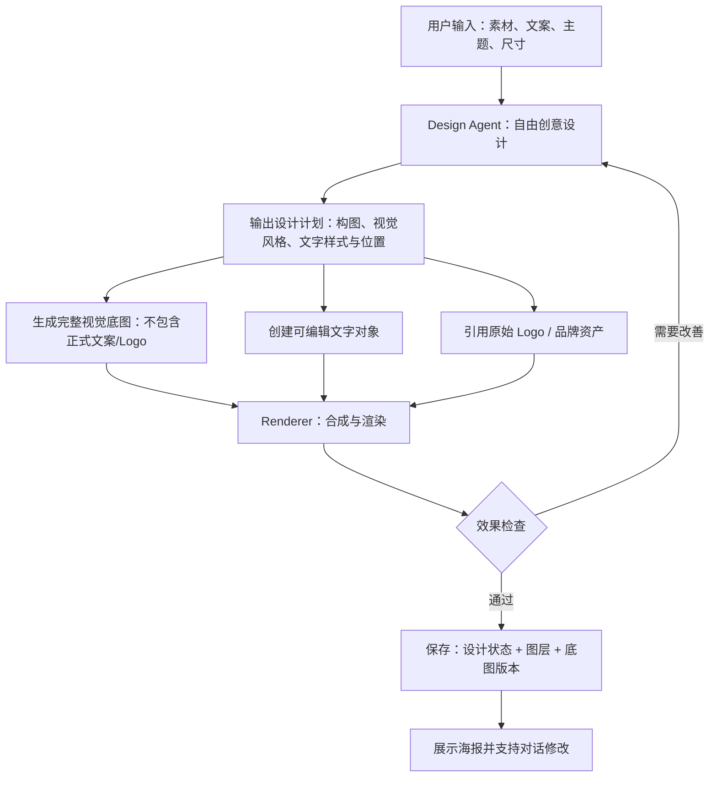
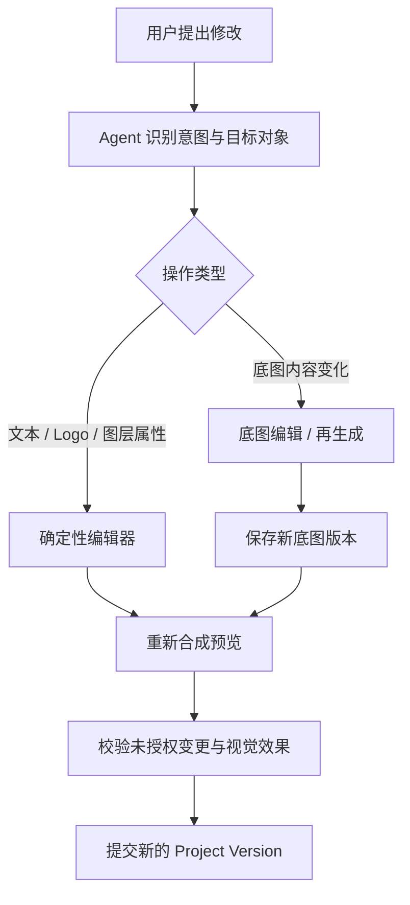
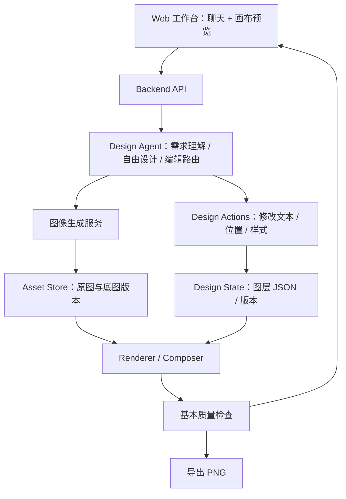

# AI 视觉设计 Agent｜MVP 产品与技术方案

> **文档版本**：V0.2（讨论稿）  
> **更新日期**：2026-10-19  
> **文档用途**：产品方向对齐、MVP 设计、后续在 GPT Desktop 中继续技术讨论与迭代  
> **当前核心方案**：**Agent 自由设计 + 最小必要分层 + 多轮精准编辑**  
> **状态**：方案讨论中，尚未进入具体实施和技术验证

---

## 0. 阅读本文件前，先了解已经达成的共识

以下结论来自此前的连续讨论，是当前的**最新决策**；若与早期“所有元素都应分层”等表达冲突，以本节为准。

1. **保留 Agent 的创意设计能力。** 用户提供素材、需求、文案和必要约束，不必提供排版或指定布局。标题位置、主体构图、字体层级、视觉风格等由 Agent 自主设计。系统不能退化为固定模板填空器。
2. **首版仅做最小必要分层。** 可独立编辑的标题、标语、副标题、价格、CTA 等文字对象必须分层；Logo、二维码等需要精确保真的品牌对象必须分层；其余产品、桌面、背景、阴影、光照、复杂装饰等可以先整体保存在一张高质量**合成底图**中。
3. **默认只改用户要求修改的内容。** 修改文字/Logo 不重新生成底图，避免多轮生成让产品或 Logo 失真。底图变化时，也不应无故修改文字和品牌对象。
4. **采用方案 B 为主、方案 A 为辅，但方案 B 在 MVP 中采用轻量实现。** 方案 B：先确定可编辑对象，再分别生成/渲染并合成；方案 A：复杂场景可以先整体生成，再在必要时分离、重建可编辑对象。**首版不追求将底图中的每个物体都拆出来。**
5. **优先实现一个可运行的 MVP，然后根据真实效果迭代。** 当前不做完整 PSD 级编辑、任意主体高保真换视角、自研生图基础模型或复杂多 Agent 系统。
6. **“视觉好看”和“后续好改”必须同时考虑。** Agent 应有排版与视觉判断权；结构化表示服务于编辑，不应反向锁死 Agent 的布局想象力。

**一句话定位：**做一个能自主完成商业视觉设计、并将文字和品牌关键元素独立为可编辑对象的 AI Agent；底图允许先保持完整美观，后续通过对话精准修改。

---

## 1. 项目背景

### 1.1 典型使用场景

用户上传 A、B、C 等参考素材，例如：

- A：牛排/商品的真实照片；
- B：品牌 Logo；
- C：设计风格参考图；
- 文字需求：标题、标语、价格、活动时间等；
- 目标：制作一张适合社交平台发布的视觉海报。

Agent 应自行理解素材、完成设计，输出美观的营销图片。用户后续通过自然语言持续修改，例如：

- “把标题改成‘周末限时特惠’。”
- “价格换成 169 元。”
- “Logo 放大一点。”
- “背景换成更高级的餐厅氛围。”

### 1.2 当前通用生图工作流的痛点

1. **多轮编辑产生视觉漂移**：反复以生成后的图片继续编辑，产品纹理、盘子形状、Logo 字母或线条可能发生变化。
2. **局部修改影响整图**：用户只修改文字，生成式编辑却可能改变牛排、背景、布局等不相关区域。
3. **扁平图片不可直接编辑**：标题和 Logo 若已被绘制进同一张 PNG，难以像设计软件那样精准替换。
4. **实际照片与目标场景存在透视、光照差异**：例如把原始牛排图片自然地放到桌子上，有时必须修改角度、阴影和空间关系，无法要求像素完全不变。
5. **全量自动分层成本过高**：强制把主体、环境、阴影和装饰全部拆开，可能损害画面一体感，也超出第一版必要范围。

### 1.3 机会

通过**自由设计生成 + 必要元素对象化 + 确定性编辑 + 版本管理**，首先解决商业海报中最常见、最容易造成返工的文案和品牌修改需求，而不在第一阶段攻克所有复杂图像编辑问题。

---

## 2. 产品定位、目标和边界

### 2.1 产品定位

**AI 视觉设计 Agent（Agentic Visual Design Tool）**

不是单纯的“输入 Prompt → 生成 PNG”，也不是传统模板排版工具，而是：

- Agent 根据需求自主设计；
- AI 负责创造有审美质量的视觉底图；
- 渲染引擎负责精确生成文本、Logo 等可编辑元素；
- Agent 将用户的后续修改转化为对设计对象的操作；
- 系统保存完整的可编辑设计状态和历史版本。

### 2.2 MVP 的用户价值

- **首轮生成有设计感**：不要求用户自己决定排版。
- **改文案可靠**：不必重新生成整张图，也不会因改字导致牛排失真。
- **品牌元素可靠**：Logo 使用原始资产，不交给模型凭印象重画。
- **可持续修改**：支持连续对话、底图版本和撤销/回滚。
- **实现范围可控**：不为全图精确分层投入过早的研发成本。

### 2.3 首批建议场景

**餐饮营销海报**（技术验证场景，并非限定未来只服务餐饮）：有商品实拍、有 Logo、有主题文案、有典型的反复改字需求，易于检验首版价值。

### 2.4 MVP 暂不支持或不承诺

- 不保证合成底图内部任意物体都能精准单独编辑；
- 不保证大幅视角转换时，产品仍与原图严格一致；
- 不承诺一键生成可完整编辑的 PSD；
- 不进行全对象自动拆层；
- 不要求一次性支持全部社交平台和批量运营流程；
- 不自研或微调基础生图模型；
- 不承诺生图模型对遮罩区域 100% 精确遵守，严格保护需在图像合成阶段执行。

---

## 3. 核心产品原则

### P1. Agent 自由设计，不是模板填充

用户提供**内容与意图**，而不是具体布局。Agent 自行选择：

- 主体摆放、视觉焦点；
- 标题位置、大小、字重和字体层级；
- Logo 摆放与留白；
- 色彩、氛围、对比度、装饰；
- 如何协调底图与文字。

Agent 可以内部形成构图规划，但这不是用户需要预先提供的固定排版模板，也不是强制在固定区域填字。

### P2. 只分离具有明确编辑价值的内容

文字和品牌信息是第一阶段的结构化重点；底图保持一个组合图层，允许包含真实商品、场景、反光、阴影等复杂内容。

### P3. 未被编辑的对象默认保持不变

对话编辑先解析“要变什么”，只修改相关对象。禁止为了简单改字而整张图重新生成。

### P4. 原始素材与生成结果分开保存

用户原始上传文件保留；底图生成出多个版本，也不覆盖原始资产。结构化文本、Logo 等始终指向各自的数据或源文件。

### P5. 区分“硬保真”和“软保真”

- **硬保真**：Logo 源文件不被重画；未授权编辑的图层数据和固定像素不改变。
- **软保真**：产品如需换背景、换视角，可采用生成式融合，但只能尽量保持形状、颜色、摆盘、数量等特征，不承诺像素不变。

---

## 4. MVP 关键能力

| 能力模块 | MVP 行为 | 说明 |
|---|---|---|
| 多素材输入 | 上传产品图、Logo、风格参考；输入文案/需求 | 输入可以不完整，Agent 尽量从上下文理解 |
| 自主创意设计 | 生成布局、字体搭配、视觉风格及整体构图方案 | **不使用强制固定模板** |
| 高质量合成底图 | 生成包含产品、场景、光影等的主视觉底图 | 底图作为整体资产，不强行拆物体 |
| 可编辑文字 | 主标题、副标题、标语、价格、CTA、商家信息 | 每项均为真实文本对象，非“画在图上的字” |
| 品牌元素分离 | Logo、二维码等作为独立图片对象 | 优先直接引用用户上传的资产 |
| 对话精准修改 | 改字、改价格、改样式、调整 Logo、底图再生成 | 对不同类型操作分流 |
| 可编辑设计状态 | 保存画布、图层、坐标、样式、资产引用 | 支撑持续编辑 |
| 版本与导出 | 历史版本、撤销/回滚、导出 PNG | 后续可扩展其他格式 |

> **非常重要**：修改文案，必须修改结构化文本，而不是给图像模型下达“把图片上的几个字改掉”的请求。

---

## 5. 首轮生图策略：自由设计 + 半结构化输出

### 5.1 核心结构

最终一张海报由以下三大层组成：

1. **合成底图层 `composite_background`**
   - 产品主体、桌面、场景、阴影、氛围光效、复杂装饰等。
   - 尽量保持完整的整体美感。
   - 首版允许作为单张位图保存。
2. **文字对象层 `text_layers[]`**
   - 主标题、标语、副标题、价格、CTA、活动时间、商家信息等。
   - 每项拥有独立内容、位置、字体、颜色、字号、尺寸与图层顺序。
3. **品牌对象层 `brand_layers[]`**
   - Logo、二维码及其他需要精确保真的品牌素材。
   - 直接引用源文件，保留原始文件与身份。

层与层之间存在**叠放顺序、透明度和坐标关系**，但在 MVP 中没有必要自动识别底图中每一套餐具或每一条阴影。

### 5.2 首轮工作流



**重要解释：**

- 图中“输出设计计划”由 Agent 自主完成，不要求用户先提供排版。
- “设计计划”可以包含标题坐标等结构化结果，但不代表使用固定布局或限制 Agent 创意。
- 生图模型负责视觉内容与氛围；程序负责准确文本和 Logo。
- 为避免正式文案被“烘焙进底图”，底图生成阶段须明确与文字渲染阶段分离。
- 如果首轮效果不够好，可以由 Agent 自主调整方案并重试，而不是直接交付机械拼贴的结果。

### 5.3 如何兼顾“底图漂亮”和“文字不烘焙进底图”

这将是 MVP 最大的技术验证点之一。

**建议的初版方法：**

1. Agent 自由提出一份完整海报创意方案（包括构图、文字视觉层级，但不固定套模板）。
2. 用这个方案驱动底图生成，明确要求底图不绘制具体正式文字和 Logo。
3. 用绘图引擎按 Agent 自定的坐标和样式渲染文字、Logo。
4. 将合成结果交给视觉模型或检查逻辑评估可读性、遮挡、美感；必要时让 Agent **重新规划和生成**，而不是强行套固定安全区。

**可选的后续增强（不强制 MVP 实现）：**先生成一张完整的创意预览供 Agent 参考，再构建不含文字的底图，并重建独立的文字/Logo 对象。该方法能参考整图视觉效果，但去字和位置还原存在工程挑战，不能保证自动准确。

### 5.4 图层结构的预期结果

```text
Project
└── Canvas (e.g. 1080 × 1440)
    ├── Text: Headline           ← 独立可编辑
    ├── Text: Slogan             ← 独立可编辑
    ├── Text: Price              ← 独立可编辑
    ├── Text: CTA                ← 独立可编辑
    ├── Brand: Logo              ← 原始素材引用
    └── Composite Background     ← 完整合成底图
         └── 牛排 + 桌面 + 光影 + 复杂装饰（MVP 不再细拆）
```

注：上面只是逻辑分类，并非最终的实际 `z-index` 排列；在具体海报里文字、Logo 和底图叠放关系由 Agent 决定。

---

## 6. 多轮编辑策略

### 6.1 识别指令，而不是无条件重生图

| 用户指令 | 目标对象 | 工具行为 | 是否调用生图 |
|---|---|---|---|
| “标题改成周末限时特惠” | 标题文本层 | `update_text` | 否 |
| “价格改为 169” | 价格文本层 | `update_text` | 否 |
| “标题大一点” | 标题文本层 | `update_text_style` | 否 |
| “Logo 移到右上角” | Logo 对象 | `move_layer` | 否 |
| “换一个 Logo” | 品牌对象 | `replace_asset_ref` | 否 |
| “背景稍微暗一点” | 合成底图 | `adjust_image` | 通常否 |
| “换成夜晚西餐厅” | 合成底图 | `regenerate_background` | 是 |
| “牛排换成龙虾” | 合成底图内部 | 重新生成或局部编辑底图 | 通常是 |
| “牛排换一个大角度” | 合成底图内部 | 受控重建/生成 | 是；不保证严格保真 |

### 6.2 多轮编辑工作流



### 6.3 默认锁定的准确含义

“默认锁定”是**操作级保护原则**，不是让所有图层在交互界面上永远不可选：

- 用户要改文字：只修改指定文本对象，其他对象数据不变。
- 用户要移动 Logo：允许更新 Logo 的坐标或缩放，Logo 源文件不变。
- 用户要改底图：形成新的底图版本，原文字和 Logo 对象不被重画。
- 多项指令一起提交：按目标集合依次或批量执行，并验证所有不相关对象未变化。

对于文本变长导致溢出的问题，Agent 可以建议调整布局，但应避免**未经确认就更改用户明确要求锁定的内容**。

---

## 7. 素材保真策略和已知技术边界

### 7.1 MVP 中重点保证的内容

- Logo 始终来自原始文件，除非用户明确要求替换。
- 文本和价格都是文本数据，不是生成式重绘的图像文字。
- 修改文字后，合成底图文件/像素保持不变。
- 生成新底图时，旧底图版本可恢复。
- 不相关的图层属性不会因一次编辑而被意外覆盖。

### 7.2 MVP 不解决的内容

对于嵌入合成底图中的牛排、餐盘或桌子：

- 不能承诺直接选中任何一件物体并严格保真地独立移动；
- 不能承诺不同相机视角转换的几何一致性；
- 更换背景涉及整个底图重新生成时，牛排局部细节可能变化；
- 后续版本才能增加抠图、Mask、受控融合、主体保真校验。

### 7.3 后续可演进的三种保真级别

| 级别 | 方式 | 适用对象 |
|---|---|---|
| L1：严格保真 | 保留源文件，确定性绘制 | Logo、二维码、文字对象 |
| L2：结构保真 | 抠图、几何变换、环境融合 | 商品、菜品、人物 |
| L3：参考重建 | 生成式重建与质量检查 | 大角度变换、复杂遮挡 |

**MVP 主要实现 L1；L2/L3 作为后续演进方向。**

---

## 8. MVP 系统架构



### 8.1 组件职责

| 组件 | 职责 | MVP 建议 |
|---|---|---|
| Design Agent | 自主创意、布局、生成参数、修改意图识别、工具选择 | 1 个主 Agent 即可 |
| Image Generation Service | 生成高质量合成底图 | 接入成熟模型 API，不自研 |
| Design State Engine | 存储画布、图层、坐标、样式、版本 | JSON 文档起步 |
| Renderer / Composer | 精确渲染文字、Logo，并叠加底图 | Canvas / Konva.js 或服务端图片合成 |
| Asset Store | 保存上传原图、Logo、底图各版本 | 本地存储起步，未来对象存储 |
| Edit Action Engine | 执行 `update_text` 等结构化修改 | 明确工具协议 |
| Basic Validator | 文本裁切、资产引用、对象级不变校验 | 优先确定性校验 |

### 8.2 建议技术栈（可替换，不构成必须依赖）

- **前端**：Next.js + React；画布可选 Konva.js。
- **后端**：Python + FastAPI。
- **Agent**：支持视觉理解、工具调用与结构化输出的多模态 LLM。
- **底图生成**：任意合适的图像生成/编辑 API。
- **文字与图像合成**：浏览器 Canvas/Konva，必要时 Pillow/OpenCV/Sharp。
- **数据存储**：首版 SQLite/PostgreSQL + 文件系统/对象存储均可，根据部署选择。
- **异步任务**：仅在生成耗时与并发需要时引入任务队列。

**实现原则：只引入当前演示链路必要的基础设施，不因为名称叫 Agent 就搭建复杂多 Agent 架构。**

---

## 9. 最小数据结构建议

下面是**示意结构**，字段可在实现时调整；不代表已实现的系统 API。

```json
{
  "project_id": "demo_001",
  "version": 3,
  "canvas": { "width": 1080, "height": 1440 },
  "original_assets": [
    { "id": "photo_001", "type": "product_image", "uri": "assets/photo_001.png" },
    { "id": "logo_001", "type": "logo", "uri": "assets/logo_001.png" }
  ],
  "layers": [
    {
      "id": "bg_001",
      "type": "composite_background",
      "asset_id": "background_v2",
      "z_index": 0,
      "locked": true
    },
    {
      "id": "headline_001",
      "type": "text",
      "content": "周末限时特惠",
      "position": { "x": 90, "y": 110 },
      "style": { "fontFamily": "Noto Sans CJK SC", "fontSize": 72, "color": "#FFFFFF" },
      "z_index": 10
    },
    {
      "id": "price_001",
      "type": "text",
      "content": "¥169",
      "position": { "x": 94, "y": 1040 },
      "style": { "fontSize": 92, "color": "#F5D39B" },
      "z_index": 11
    },
    {
      "id": "logo_layer_001",
      "type": "brand_asset",
      "asset_id": "logo_001",
      "position": { "x": 830, "y": 45 },
      "size": { "width": 180, "height": 110 },
      "z_index": 12
    }
  ],
  "background_versions": ["background_v1", "background_v2"],
  "design_brief": "高端餐厅牛排促销海报，构图和排版由 Agent 自主设计"
}
```

### 9.1 最小编辑协议

```json
{
  "base_version": 3,
  "actions": [
    { "type": "update_text", "layer_id": "headline_001", "content": "周末双人套餐" },
    { "type": "move_layer", "layer_id": "logo_layer_001", "position": { "x": 780, "y": 60 } }
  ]
}
```

建议所有修改先由 Agent 生成操作计划，再由代码验证合法性并执行。避免让自然语言直接覆盖项目状态。

---

## 10. MVP 典型演示流程

**演示主题：一张牛排营销海报从首轮生成到连续编辑。**

1. 上传牛排照片、Logo、风格参考图，输入“做一张有高级感的餐厅优惠海报，价格 199 元”。
2. Agent 自由设计构图，生成底图，并叠加独立标题、价格、Logo。
3. 用户输入“把主标题改为‘周末限时特惠’”。系统仅更新标题对象，底图及 Logo 无变化。
4. 用户输入“价格从 199 改成 169”。仅更新价格对象。
5. 用户输入“Logo 放大一点”。调整 Logo 对象的显示尺寸，不重绘 Logo。
6. 用户输入“背景更有夜晚餐厅的氛围”。生成新底图版本，保留文字与 Logo 对象，视需要重新检查可读性。
7. 用户继续多轮改字、移位、改样式，测试未授权区域稳定性。
8. 用户选择历史版本回滚，并导出 PNG。

### 10.1 MVP 验收标准

**硬指标：**

- 修改文字或价格时，底图资产内容不变；
- 修改文字或价格时，Logo 原始文件引用不变；
- Logo 不被生图模型重新绘制；
- 每个设计版本可回滚且渲染重现；
- 文字修改后能正确渲染新内容，不存在生成式拼写错误；
- 编辑操作只更新指定图层的状态，未经授权的图层属性不改变。

**软指标（需测试评估）：**

- 首轮底图与排版的整体美观度；
- 文字和场景风格是否协调；
- 文本较长时的可读性与布局调整质量；
- 改变底图后，仍可保持合理视觉呈现；
- 单次生成与编辑的耗时、费用、失败率。

> 注意：**仅验证 10 次编辑不失真还不够**；应同时检查首轮设计是否好看，以及每次编辑是否确实符合用户意图。

---

## 11. 开发阶段划分（建议顺序，非固定日程）

### 阶段 1：最小结构化渲染原型

- 创建 `composite_background`、`text`、`brand_asset` 三类对象。
- 从 JSON 生成一张完整海报。
- 验证修改文本不会触碰底图像素。

### 阶段 2：接入 Agent 自由设计与底图生成

- Agent 根据原素材和文案自主产出创意方案。
- 生图 API 生成底图；Agent 输出文字层样式与坐标。
- 合成预览，确保不是简单套模板。

### 阶段 3：自然语言多轮编辑

- 支持改文案、价格、样式、Logo 位置/大小。
- 增加编辑动作协议、校验、失败提示。
- 保持底图独立。

### 阶段 4：底图版本与视觉校验

- 支持底图再生成、版本回滚。
- 对基本可读性、溢出、遮挡进行检测。
- 跑连续编辑测试，记录案例与问题。

### 后续扩展（不纳入 MVP 必交）

- 主体对象抠图与分层；
- 受控的产品与场景融合；
- 带 Mask 的局部生成和硬像素保护；
- 多平台智能尺寸适配；
- 品牌资产库与模板/任务复制；
- 更成熟的设计质量评价和自动多方案筛选。

---

## 12. 核心风险与验证计划

| 风险 | 影响 | MVP 处理思路 |
|---|---|---|
| Agent 排版自由，但底图无法给文字提供合理空间 | 成品像拼贴，质量差 | Agent 全局规划 + 合成预览 + 必要时重新规划与生成 |
| 图片模型意外生成文字/仿 Logo | 底图中出现重复字、错误商标 | 生成约束 + 视觉检查；必要时重生底图 |
| 独立文字渲染的字体与背景美术风格脱节 | 商业观感差 | Agent 同时设计字形、层级、颜色、对比和装饰；可选文本阴影、描边、形状背板 |
| 文案变长发生溢出 | 无法精准交付 | 自动排版检查；明确什么时候允许修改其他属性 |
| 底图整体重生造成产品变化 | 商品不够真实或失真 | 明确 MVP 边界，保留原图与版本；后续引入主体保护 |
| 工具链过度复杂 | MVP 开发缓慢 | 一个 Agent + 少量确定性工具 + 成熟生图 API |
| 自动美学评价不稳定 | 好看的稿件被错误淘汰 | 让用户最终挑选与确认；自动评价只做辅助 |

### 12.1 推荐先做的三个小实验

1. **无字底图与独立排版实验**：同一设计任务生成多张海报，比较整体生图与“底图+独立文字”的视觉质量。
2. **重复编辑稳定性实验**：连续修改标题、价格、Logo 位置 10 次，检查未修改资产与图层状态是否完全不变。
3. **背景替换实验**：保留文字与 Logo，替换整体底图，看 Agent 是否能让新设计保持完整美感。

---

## 13. 尚未确定的设计问题

这些问题**不阻碍先做原型**，可以在实现中通过样例验证。

1. **首轮视觉设计究竟如何规划与评价？** 是输出结构化布局后生成底图，还是生成几版创意预览再重建图层？
2. **独立文字需要多强的视觉效果表达？** 普通文字、描边、阴影、渐变、变形字、路径文字分别何时支持？
3. **文字与底图的前后遮挡关系如何处理？** MVP 可先采取常规覆盖，复杂穿插效果后续再支持 Mask。
4. **底图生成时如何使用用户产品原图？** 作为参考重建，还是优先按原图融合？需要区分不同的保真期望。
5. **选择哪一个生图服务最适合 MVP？** 需基于底图质量、参考图一致性、编辑能力、耗时与成本实测，而不是先锁定供应商。
6. **首版界面复杂度如何控制？** 建议对话 + 结果预览为主，可在下一步加入简单的图层列表与元素选中。
7. **首版目标用户与部署方式**：内部验证还是对外演示，决定鉴权、并发和任务系统复杂度。

---

## 14. 后续方向：从 MVP 演进到更强的素材保真 Agent

**V1（当前）**：Agent 自由设计 + 文字/Logo 分层 + 完整合成底图 + 精准修改与版本化。

**V2（增强）**：选择性增加产品主体层；产品抠图、透明图层、边缘/阴影处理；底图可做一定程度的区域编辑。

**V3（复杂融合）**：根据用户需求选择原图合成、受控透视/光影融合、参考重建；引入主体结构一致性校验。

**V4（产品化）**：多尺寸适配、品牌库、任务复用、批量出图、协作与质量评测体系。

> 路线以实际实验结果决定，避免为了技术完整性牺牲早期交付速度。

---

## 15. 导入 GPT Desktop 后的续聊交接说明

### 15.1 当前已有的最终决定（请不要重新推回全量拆层）

- 用户的根本目标是**AI 自主设计能力**，并非手动排版/固定模板。
- 用户希望**最小成本做出一个可运行 MVP**，再逐步改进。
- 文本（标题、标语、价格等）需独立可编辑；Logo 等品牌资产需独立且精确保真。
- 产品、场景、光影等复杂视觉内容可以先合为一张高质量底图，不强制自动分层。
- 方案 B（预先规划可编辑对象并分别生成/渲染）为主，方案 A（复杂情况下整体生成后再拆/重建）作为补充，不能把 A 变成首版默认的“先生成带文字整图再拆”。
- 多轮修改应以结构化编辑优先，不应为改字再次整图生图。
- 牛排换桌面/换视角属于后续受控融合能力，不能强行用严格像素锁定去解决。

### 15.2 希望下次继续讨论的优先主题

**优先：首轮自由创意设计到半结构化海报的实际实现。**

需要进一步给出：

1. 最小可运行模块与函数边界。
2. Agent 输出的结构化设计方案 Schema（既保留自由创意，又能被渲染）。
3. 首轮生成底图与文字/Logo 合成的 Prompt/调用方式。
4. 视觉质量迭代与可读性校验的最简单有效方案。
5. 一组可以真正开始编码的实现步骤与最小测试案例。

### 15.3 可直接复制给下一轮 GPT 的请求

> 请阅读我上传的《AI 视觉设计 Agent｜MVP 产品与技术方案 V0.2》。本项目已决定采用**Agent 自由设计 + 最小必要分层**：文字和 Logo 独立，其他复杂视觉先保留为高质量合成底图；方案 B 为主、A 为辅。**不要把它重新设计成模板排版工具，也不要一上来追求全量分层。**请基于这个方向，帮我设计可编码的 MVP 最小技术实现：首轮创意设计与生图链路、Agent 的结构化输出、渲染合成、自然语言改字、版本保存、质量检查，并清楚区分必须实现与未来扩展。先给出架构与模块接口，不必一次性写完所有代码。

---

**文档结束｜V0.2，后续根据实际讨论与实验升级版本。**
