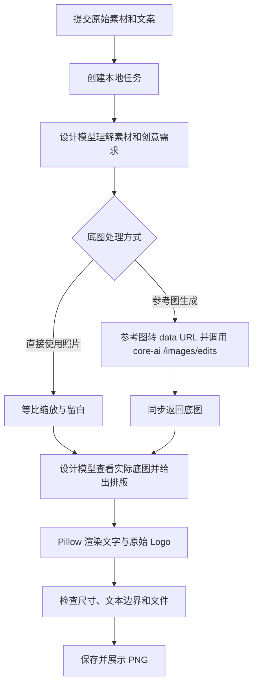

# AI 视觉设计 Agent 首版开发计划

> 版本：V0.1 · 2026-10-19  
> 目标：先做出可以实际使用的单张海报生成流程。  
> 执行说明：按第 10 节逐项开发；如由 AI 编码助手执行，可使用 `superpowers:executing-plans` 逐项验收。本文是开发计划，所列代码文件尚未实现。

> **实施更新（2026-10-19）**：本地 MongoDB 改用根目录 `docker-compose.yml` 启动，映射到 `127.0.0.1:27018`（27017 已被本机其他服务占用）；图片对象改用腾讯云 COS，MongoDB 只保存对象键，预览和下载通过 COS 预签名 URL；首版生图使用 `gpt-image-2.5-flare`，设计模型暂未启用。前端增加左侧菜单「海报生成 / 资产管理」，生成海报时必须从资产库选择商品图；海报生成页保留提示词输入并传给生图服务（当时为 ToAPIs，2026-10-20 已迁移到 core-ai），标题、副标题、价格字段移除。扩展支持最多 4 张商品图融合、1:1/9:16/4:5/16:9 比例、资产删除，以及从 `素材/` 同步素材到 COS；提示词中的文案由生图模型渲染，需人工校对。其余范围以本文为准。

> **迁移更新（2026-10-20）**：运行时已不再调用 ToAPIs。生图、改图、设计规划、排版规划和自然语言编辑统一走 core-ai 网关（`CORE_AI_GATEWAY_BASE_URL`，默认 UAT 地址）。参考图不再上传，直接以 `input_images: [{"b64Json": "data:image/...;base64,..."}]` 提交；生图与改图为同步请求，不再有提交、轮询、下载阶段。接口、配置与调用链以本节和第 4 节为准。

**Goal：**上传商品实拍图、可选 Logo 和风格参考，填写需求及文案，由 Agent 自主设计，输出可预览、可下载的 PNG。

**Architecture：**一个 React 页面、一个 FastAPI 服务、通过 Docker 运行的本地 MongoDB（27018）和 COS/本地图片存储。Agent 负责创意与排版；core-ai 网关负责生成底图、局部改图和对话模型；Pillow 确定性合成文字和原始 Logo。

**Tech Stack：**React + TypeScript + Vite；Python 3.12 + FastAPI + Pydantic + PyMongo + HTTPX + Pillow；core-ai 网关：图像模型 `gpt-image-2.5-flare`，设计模型 `gpt-6.1-sol`，编辑模型 `deepseek-v4-flash`，均通过配置替换。

本文按用户最新要求收敛范围。[design.md](./design.md) 保留长期设计方向；本次开发范围以本文为准。

## 1. 首版范围：只把第一次出图做好

### 1.1 必须完成

1. 上传 1 张商品／菜品图；可选上传 1 张 Logo、1 张风格参考。
2. 填写设计需求、标题，以及可选副标题和价格。
3. Agent 理解素材，自行决定构图、颜色、文字位置与大小。
4. 输出一张海报：底图 + 真实文本渲染 + 原始 Logo 合成。
5. 显示处理阶段、失败原因，支持查看原图和下载 PNG。
6. 保存输入、设计结果、模型任务 ID、底图和成品，刷新页面仍能查看当前任务。

首版画布为 **1024 × 1024**，后续扩展到 9:16、4:5、16:9。core-ai 图像接口使用 OpenAI 风格像素尺寸 `WxH`：按画布或裁切区域计算，向下取 16 的倍数，最长边不超过 3840（如 1080×1920 发送 `1072x1920`）。

### 1.2 暂缓开发

多轮聊天编辑、换背景编辑、自动抠图／Mask、画布拖拽、图层面板、撤销和版本树、多平台套图、品牌库、任务模板、批量生成、账号权限、多人协作、自动发布、计费界面、自动美学打分循环。

底层仍保存文本与 Logo 的设计数据，但首版不暴露编辑接口。重新点击生成会创建新任务，并使用用户上传的原始素材，不把上一张成品作为新素材继续重画。

### 1.3 保真的实际边界

- 文字来自用户填写的数据，Logo 来自上传资产，由代码渲染与合成。
- 商品原图始终保存。Agent 可以选择直接使用照片，或以照片作为参考生成场景。
- 用户强调商品必须保持原貌时，选择直接使用照片，允许等比缩放、摆放和留白；不要偷偷改为生成式重建。
- 参考图生图仍可能改变商品细节；首版需要人工对照原图检查，不能把提示词中的“保持一致”当成保真保证。
- 首版验证的是首次出图。多轮编辑的保真能力属于后续版本验收，不在这一版宣称已解决。

## 2. 技术选型

| 部分 | 采用 | 用途与选择原因 |
|---|---|---|
| 前端 | React + TypeScript + Vite | 单页上传、表单、状态和图片预览；当前不需要 SSR |
| UI | 普通 CSS + 原生表单 | 先做好一个页面，减少 UI 依赖 |
| 状态与请求 | React state + fetch | 当前任务规模不需要 Redux、路由框架或查询库 |
| 后端 | Python 3.12 + FastAPI | HTTP 接口、文件上传和流程编排 |
| 参数校验 | Pydantic v2 + pydantic-settings | 请求、Agent 输出和环境变量校验 |
| 数据库 | Docker MongoDB + 同步 PyMongo | 本地 27017 端口，保存任务、输入快照、设计 JSON、素材元数据 |
| 文件 | 本地 `storage/` | 原图、生成底图、最终 PNG |
| 模型请求 | HTTPX 同步客户端 | core-ai `/chat/completions`、`/images/generations`、`/images/edits` |
| 图像合成 | Pillow | 图片尺寸处理、中文字体、文本和 Logo 合成 |
| 任务执行 | FastAPI BackgroundTasks | 返回任务 ID 后在当前进程执行，首版无需 Redis/Celery |
| 测试 | pytest + HTTPX MockTransport | 验证关键解析、排版与失败分支，默认不调用付费模型 |

FastAPI 支持返回响应后执行后台函数。这里统一采用同步 `def` 任务和同步客户端，避免在 `async def` 中直接进行阻塞请求。[BackgroundTasks 官方说明](https://fastapi.tiangolo.com/tutorial/background-tasks/)

数据库使用 PyMongo 即可，不引入 ODM。以后需要异步数据库访问时，再使用 PyMongo Async；新项目无需再选 Motor。[PyMongo 说明](https://www.mongodb.com/docs/languages/python/pymongo-driver/current/reference/migration/)

运行约束：**本机使用、一个后端进程、一个 Uvicorn worker**。BackgroundTasks 不是持久化任务队列；服务重启的处理见第 8 节。

## 3. MongoDB 存什么，图片放哪里

**MongoDB 适合本项目。首版只使用 MongoDB，不同时引入 MySQL。**任务和设计状态主要是嵌套文档，没有复杂关联查询。

图片本体存本地，MongoDB 保存相对路径、尺寸、类型和哈希。不要把整张图片的 Base64 塞进任务文档。MongoDB 普通 BSON 文档有 16 MiB 上限；虽然也可以使用 GridFS，但当前本地文件更直接。[MongoDB 文件存储说明](https://www.mongodb.com/docs/manual/core/gridfs/)

建议数据库名 `social_media`，只建两个集合：

### 3.1 `assets`：文件元数据

```json
{
  "_id": "asset_product_001",
  "kind": "product",
  "original_name": "steak.jpg",
  "path": "originals/asset_product_001.jpg",
  "mime_type": "image/jpeg",
  "width": 1600,
  "height": 1200,
  "bytes": 284000,
  "sha256": "<文件内容哈希>",
  "provider_upload_url": null,
  "created_at": "2026-10-19T08:00:00Z"
}
```

`kind` 枚举：`product`、`logo`、`style_reference`、`background`、`output`。实际 ID 使用 UUID 字符串；时间在 MongoDB 中存 UTC datetime，对外返回 ISO 8601。

`provider_upload_url` 只是调用服务的辅助信息，不是永久原图地址。模型使用经过方向纠正、必要压缩的派生文件时，也保存派生路径，原始上传文件不覆盖。

### 3.2 `tasks`：一次生成

```json
{
  "_id": "task_001",
  "schema_version": 1,
  "status": "queued",
  "stage": "pending",
  "input": {
    "brief": "高级餐厅牛排促销海报，保留真实菜品特点",
    "product_asset_id": "asset_product_001",
    "logo_asset_id": null,
    "style_asset_id": null,
    "copy": { "title": "周末限时特惠", "subtitle": "", "price": "¥169" }
  },
  "canvas": { "width": 1024, "height": 1024 },
  "creative_plan": null,
  "design": null,
  "repair_count": 0,
  "provider": {
    "name": "core-ai",
    "model": "gpt-image-2.5-flare",
    "task_id": null,
    "status": null,
    "progress": 0
  },
  "background_asset_id": null,
  "output_asset_id": null,
  "error": null,
  "created_at": "2026-10-19T08:00:00Z",
  "updated_at": "2026-10-19T08:00:00Z"
}
```

首版按 `_id` 查找，使用 MongoDB 自带唯一索引即可。没有历史列表页面时，先不增加额外索引和版本集合。

保存顺序：文件写入临时文件 → 完成后原子改名 → 写入素材记录 → 更新任务为成功。成功状态必须意味着成品已经能够读取。

## 4. 生图与设计模型接入

### 4.1 生图：core-ai 同步图像接口

实现见 `backend/app/services/core_ai.py`。无参考图时调用 `POST {CORE_AI_GATEWAY_BASE_URL}/images/generations`；有参考图（底图生成、背景重生成、Logo 局部融合）时调用 `POST {CORE_AI_GATEWAY_BASE_URL}/images/edits`。两者都是同步请求，默认 `n=1`、`quality=high`、`output_format=png`，不传 `background`。

**接口约束：**

- 鉴权使用 `Authorization: Bearer <CORE_AI_API_KEY>`，密钥只从 `backend/.env` 读取。
- `size` 使用 OpenAI 风格 `WxH`：按实际画布或裁切区域计算，向下取 16 的倍数，最长边不超过 3840。例如 `1080×1920` 发送 `1072x1920`，`1080×1350` 发送 `1072x1344`。
- 网关对过小的区域会返回“低于最小像素预算”。Logo 局部融合等小裁切会按比例放大到至少 `1024×1024` 像素后再请求，返回结果再缩回原裁切尺寸。
- 改图请求体使用 `input_images: [{"b64Json": "data:image/...;base64,..."}]`，顺序即参考图顺序；Logo 融合固定为“图1局部底图、图2透明 Logo”。
- 商品图与裁切图转为最长边 1536、JPEG 质量 88 的 data URL；带透明通道的 Logo 转最长边 1024 的 PNG data URL。单张超过约 1.5 MB 时递减质量或尺寸，单次请求总大小限制 8 MB。
- 响应兼容 `data[0].b64_json` 和 `data[0].url`。URL 仅允许 HTTPS 公网地址，拒绝内网/回环目标，限制重定向次数和下载体积。

请求示例：

```json
{
  "model": "gpt-image-2.5-flare",
  "prompt": "以图1中的菜品为主体，保持数量、外观和摆盘，设计暖色餐厅氛围和适合排版的留白。",
  "n": 1,
  "size": "1072x1024",
  "quality": "high",
  "output_format": "png",
  "input_images": [{"b64Json": "data:image/jpeg;base64,..."}]
}
```

### 4.2 结果、超时与失败

- 成功：保存 `provider.name=core-ai`、`provider.model=gpt-image-2.5-flare`、`provider.task_id=null`、`provider.status=completed`。
- 网关超时、连接中断或上游 5xx：任务标记 `failed`，提示“结果未知，可能已产生费用，请确认后重新生成”，不进入 `waiting`。
- 429 按 `Retry-After` 最多重试一次；5xx 不自动重试，避免重复计费。
- 旧 `waiting` / `interrupted` 任务和已有底图任务仍标记 `can_resume=true`；恢复会重新发起一次网关请求。
- 网关错误统一解析 core-ai 的 `errorCode` / `error.message` 与 OpenAI 风格 `error`，对 401、403、429、5xx、超时和非 JSON 响应给出可读提示。

### 4.3 设计：视觉语言模型，负责创意和排版

设计规划、排版规划和自然语言编辑统一使用 `POST {CORE_AI_GATEWAY_BASE_URL}/chat/completions`，`stream=false`，读取 `choices[0].message.content`。设计模型为 `gpt-6.1-sol`，编辑模型为 `deepseek-v4-flash`，通过 `CORE_AI_DESIGN_MODEL` / `CORE_AI_EDIT_MODEL` 配置。

图像输入使用文字与 `image_url` 内容块，图片为本机派生图的 data URL。提示词要求只输出 JSON；解析兼容 Markdown 代码块，业务校验失败最多修正一次，仍失败就结束任务，不循环调用模型。

统一用 HTTPX 请求即可，不需要 LangChain、LangGraph、Agents SDK 或通用供应商插件系统。

## 5. 生成流水线与模块边界



### 5.1 创意规划 `make_creative_plan(input, assets)`

输入：设计需求、原始商品图、可选风格参考和需要放入的文案。

输出：

```json
{
  "background_mode": "reference_generate",
  "creative_direction": "暖色、高级餐厅氛围，突出菜品，右上方为文案留白",
  "image_prompt": "<根据真实素材分析生成的底图提示词>",
  "preserve_features": ["一份菜品", "原有餐盘", "主要配菜和摆盘关系"],
  "photo_frame": null
}
```

`background_mode` 只允许 `use_original` / `reference_generate`。直接使用原图时，`photo_frame` 给出放置矩形和画布背景色；用 `contain` 等比放置完整照片，首版不做商品抠图或透视变换。生成路径下 `photo_frame=null`。

`preserve_features` 是规划约束和人工检查依据，不能当作自动检测已通过。风格参考只用于风格，不能取代用户商品。Logo 不放入底图生图请求，留给后续代码合成。

### 5.2 底图处理 `build_background(task, creative_plan)`

- 原图路径：读取原始素材的派生图，按计划缩放放入画布。
- 生图路径：读取商品和可选风格参考；明确参考图顺序与角色；参考图转 data URL 后同步调用 core-ai，保存返回底图。
- 两条路径都产出本地底图文件和实际宽高，写入 `assets`。
- 画布尺寸由后端确定；网关返回尺寸异常时明确报错，不能静默拉伸商品。

### 5.3 排版规划 `make_layout(background, input)`

让设计模型查看**已经得到的底图**，然后选择文字与 Logo 的坐标、大小和颜色。给它可用字体清单、文本字段、Logo 比例及画布尺寸。

模型输出布局，不重新抄写用户文字；文字内容由代码按照 `field` 从输入读取。这样不会出现模型改错价格或漏字。

示例：

```json
{
  "texts": [
    {
      "field": "title",
      "box": { "x": 64, "y": 64, "width": 700, "height": 150 },
      "font_key": "sans_bold",
      "font_size": 64,
      "color": "#FFFFFF",
      "align": "left",
      "line_spacing": 12,
      "backplate_color": "#20180FCC"
    },
    {
      "field": "price",
      "box": { "x": 64, "y": 820, "width": 360, "height": 140 },
      "font_key": "sans_bold",
      "font_size": 80,
      "color": "#F5D39B",
      "align": "left",
      "line_spacing": 8,
      "backplate_color": null
    }
  ],
  "logo_box": null
}
```

校验规则：

- `field` 只能是非空的 `title`、`subtitle`、`price`；每个非空字段恰好出现一次。
- 所有坐标是画布像素坐标，左上角为原点；矩形必须在画布内。
- 字体只能从服务端字体表选择；首版字号范围 16–160，颜色只接受 HEX。
- Logo 上传存在时必须给出 `logo_box`，否则必须为 null；渲染时在框内等比缩放。
- 文字与 Logo 的矩形不得相互遮挡；商品主体的语义遮挡先由模型规划与人工验收检查。
- 空字段不生成图层；限制图层数量，拒绝任意脚本、路径或其他资产引用。

### 5.4 合成 `render_poster(background, layout, copy, logo)`

只实现常用的水平文字、左／中／右对齐、换行和可选单色半透明背板。无需首版实现曲线文字、渐变字、3D 字、独立形状编辑器。

准备固定的中文常规和粗体字体文件，例如 Noto Sans CJK SC，随项目保留字体许可文件，使用 `sans_regular` / `sans_bold` 映射。不要依赖每台机器安装了相同字体。

使用 Pillow 的 `textbbox` / `multiline_textbbox` 测量文本，再绘制；中文字按可用宽度换行，英文尽量按词换行。溢出时在框内逐步缩小字号至最小值，仍放不下就返回布局错误，不截断文案。[Pillow 文字绘制](https://pillow.readthedocs.io/en/stable/reference/ImageDraw.html)

实际使用的字号、换行、坐标和源文本保存为 `design`。底图、文字和 Logo 先分别存在数据中，最后输出扁平 PNG，前端只显示这张 PNG。

### 5.5 首版质量检查

代码检查尺寸、图片可解码、字体文件存在、必填文案完整、图层边界和 Logo 资产引用。人工对照原图检查商品细节与整体美感。

每个任务正常最多：一次创意规划、一次底图生图、一次排版规划；整个流程最多额外一次 JSON／布局修正，修正不重新生图。模型拒绝、内容过滤、截断或缺少有效输出都返回明确错误，不进入无限重试。

## 6. 前端页面与后端 API

### 6.1 一个页面即可

**前端开发要求：必须引用 [menupilot-design skill](C:/Users/simonzheng/.codex/skills/menupilot-design-skill/SKILL.md) 进行页面开发。首版功能范围以本计划为准。**

左侧：三个素材输入框、设计需求、标题、副标题、价格、生成按钮。商品图和标题必填；其他字段可空。先支持中文与英文。

右侧：素材缩略图、生成阶段、最终海报、下载按钮。生成期间保留表单，禁用重复提交。失败时显示原因，允许保留输入后创建新任务；等待超时则提供继续查询入口。

URL 用 `?task=<id>` 保存当前任务 ID，无需路由库。刷新后通过 API 恢复任务；首次没有任务 ID 时显示空表单。前端每 2 秒查询**本地后端**，后端在后台线程同步调用 core-ai 网关。

### 6.2 API 合约

| 接口 | 请求 | 成功响应 |
|---|---|---|
| `GET /api/health` | 无 | 数据库与本地目录健康状态；不调用付费模型 |
| `POST /api/assets` | multipart：`file`、`kind` | `201`，素材 ID、尺寸、预览 URL |
| `GET /api/assets/{id}/file` | 无 | 按数据库记录返回本地图片 |
| `POST /api/tasks` | 下述 JSON | `202`，本地任务 ID 与状态 |
| `GET /api/tasks/{id}` | 无 | 状态、阶段、输入、结果 URL、错误；无密钥 |
| `POST /api/tasks/{id}/resume` | 无 | `202`，继续已有任务的查询／下载／合成 |
| `GET /api/tasks/{id}/download` | 无 | 成功任务的 PNG，附件下载 |

`resume` 只是恢复一次生成流程，不是多轮编辑。兼容旧的 `waiting` / `interrupted` 任务，也允许已有底图但未完成渲染的任务恢复；使用条件更新领取任务，重复调用不创建多个执行器。恢复会重新发起一次 core-ai 网关请求。

```json
{
  "brief": "做一张暖色、高级感的牛排促销海报",
  "product_asset_id": "asset_product_001",
  "logo_asset_id": null,
  "style_asset_id": null,
  "copy": { "title": "周末限时特惠", "subtitle": "", "price": "¥169" }
}
```

服务端校验：brief 1–2000 字符，title 1–40，subtitle 0–100，price 0–30；资产 ID 必须存在且角色匹配。价格用字符串原样处理，不自动补币种、折扣或活动条件。

上传仅接收 JPEG、PNG、WebP，单文件不超过 **10,000,000 字节**，解码像素上限 2500 万。校验实际图片格式，生成自己的 UUID 文件名；服务端纠正 EXIF 方向，保留原文件；Logo 保留透明通道。SVG 和 GIF 首版不接受。

外部下载使用单独的 HTTPX 客户端，不携带 core-ai Authorization。仅处理网关返回的图片 URL，限制 HTTPS、公网目标、重定向、超时和最大体积，不提供用户任意 URL 下载接口。文件服务只能通过资产 ID 读取 storage 内的文件。

## 7. 项目目录与核心函数

```text
social-media/
├── doc/
│   ├── design.md
│   ├── media-agent.png
│   └── plan.md
├── frontend/
│   ├── package.json
│   ├── package-lock.json
│   ├── vite.config.ts
│   └── src/
│       ├── App.tsx
│       ├── api.ts
│       ├── types.ts
│       ├── styles.css
│       └── components/
│           ├── GenerateForm.tsx
│           └── ResultPanel.tsx
├── backend/
│   ├── requirements.txt
│   ├── requirements-dev.txt
│   ├── .env.example
│   ├── app/
│   │   ├── __init__.py
│   │   ├── main.py
│   │   ├── config.py
│   │   ├── db.py
│   │   ├── schemas.py
│   │   ├── routes/
│   │   │   ├── __init__.py
│   │   │   ├── assets.py
│   │   │   └── tasks.py
│   │   ├── services/
│   │   │   ├── __init__.py
│   │   │   ├── storage.py
│   │   │   ├── core_ai.py
│   │   │   ├── designer.py
│   │   │   ├── renderer.py
│   │   │   └── pipeline.py
│   │   └── prompts/
│   │       ├── creative.txt
│   │       └── layout.txt
│   ├── fonts/
│   │   ├── NotoSansCJKsc-Regular.otf
│   │   ├── NotoSansCJKsc-Bold.otf
│   │   └── LICENSE
│   └── tests/
│       ├── test_assets.py
│       ├── test_core_ai.py
│       ├── test_layout.py
│       ├── test_renderer.py
│       └── test_pipeline.py
├── storage/
│   ├── originals/
│   ├── prepared/
│   ├── backgrounds/
│   └── outputs/
└── .gitignore
```

上面是业务文件边界；Vite 初始化生成的入口、配置文件正常保留，不再人为拆出 controller/repository/manager 等多层。

| 文件 | 主要函数或职责 |
|---|---|
| `db.py` | 初始化一个 MongoClient；访问 assets / tasks |
| `storage.py` | `save_upload`、`prepare_image`、`save_generated_image`、受限路径解析 |
| `core_ai.py` | `generate_image`、`edit_image`、`chat_json`、参考图编码、结果下载与安全校验 |
| `designer.py` | `make_creative_plan`、`make_layout`、输出业务校验 |
| `renderer.py` | `build_photo_background`、`fit_text`、`render_poster` |
| `pipeline.py` | `run_task(task_id)`，读写阶段、处理失败和恢复 |
| `routes/tasks.py` | 创建／查询／恢复／下载任务，调用 BackgroundTasks |

## 8. 状态、超时与失败处理

本地任务状态：`queued` → `running` → `succeeded` / `failed`。兼容旧的 `waiting`（历史异步任务停止等待）和 `interrupted`（本地服务重启）。

`stage`：`pending`、`planning`、`generating`、`layout`、`integrating_logo`、`rendering`、`done`。新任务不再出现 `uploading`、`submitting`、`downloading`。进度固定为：规划 5%、生成 20–70%、排版 82%、Logo 融合 90%、渲染 96%、完成 100%。

默认超时：连接 15 秒，图像请求读取 300 秒（`CORE_AI_IMAGE_TIMEOUT_SECONDS`），对话请求 120 秒（`LLM_TIMEOUT_SECONDS`）。

必要规则：

1. 生图/改图请求前先把任务写成 `running`，持久化当前阶段与进度；同步请求返回后直接保存底图并进入排版。
2. 网关超时或连接中断视为结果未知：任务标记 `failed`，提示“结果未知，可能已产生费用，请确认后重新生成”，不自动重发。
3. 上游 5xx 直接标记失败；429 按 `Retry-After` 最多重试一次。
4. 下载失败可重试下载；排版失败可使用已有底图重新排版，不重新生图。超过本次修正预算则记录失败。
5. 服务启动时将旧 `queued/running` 标记 `interrupted`，不自动发起付费请求。恢复优先读取已保存成品或底图；需要重新生成时明确提示会再次调用网关。
6. 如果中断明确发生在生图请求之前，可让用户保留输入重新创建任务。首版不做通用断点恢复引擎。
7. 网关返回成功但没有图片数据或 URL，作为明确协议异常处理，不当作成功。
8. 本地任务更新使用条件状态更新，成功和失败都写 `updated_at`；前端断网不能把服务器任务改成失败。

普通 GET 遇网络错误可有限退避重试；401、402、参数错误直接提示。错误响应只返回代码和简洁说明，原始诊断保留服务端，日志不写 API Key 或完整图片 Base64。

## 9. 配置与本地启动

### 9.1 环境准备

- Node.js 22.12+ 的 22.x 版本，或满足 Vite 当前要求的更新受支持版本。[Vite 要求](https://vite.dev/guide/)
- Python 3.12。
- Docker Desktop 已运行并使用 Linux containers；MongoDB 按第 9.2 节启动，固定映射本机 27017 端口。
- core-ai API Key 从本机 `~/.core-ai/auth.json` 读取后写入已被 gitignore 忽略的 `backend/.env`；不要提交或打印密钥。所选模型的账号权限在接入时验证。
- 两个可用的中文字体文件。

`.env.example`：

```dotenv
MONGODB_URI=mongodb://127.0.0.1:27018
MONGODB_DATABASE=social_media
STORAGE_DIR=../storage
SAMPLE_DIR=../素材
SKILLS_DIR=../.agents/skills

CORE_AI_GATEWAY_BASE_URL=https://core-ai-server.connexup-uat.net/api/gateway/v1
CORE_AI_API_KEY=replace_me
CORE_AI_IMAGE_MODEL=gpt-image-2.5-flare
CORE_AI_DESIGN_MODEL=gpt-6.1-sol
CORE_AI_EDIT_MODEL=deepseek-v4-flash
CORE_AI_IMAGE_QUALITY=high
CORE_AI_IMAGE_TIMEOUT_SECONDS=300

LLM_TIMEOUT_SECONDS=120
```

`CORE_AI_GATEWAY_BASE_URL` 已包含 `/api/gateway/v1`，代码只拼接 `/chat/completions`、`/images/generations`、`/images/edits`。`STORAGE_DIR` 相对 backend 目录解析成绝对路径，不能随启动工作目录变化。字体路径也相对 backend 目录定位。

密钥已放入本地 `backend/.env`，由 config 明确加载。计划文档及 `backend/.env.example` 只保留 `replace_me` 占位符。根目录 `.gitignore` 已排除 `.env`、其他本地环境文件、虚拟环境、node_modules、storage 和测试缓存，同时保留 `.env.example`。开发时沿用现有 `.env`，不要用模板覆盖已填写的密钥。首版不读取或修改 MySQL 配置。

### 9.2 Docker 启动 MongoDB（开发时执行）

采用 Docker Official Image `mongo:8.0`，容器名 `social-media-mongo`，命名卷 `social-media-mongo-data`。首版本机开发使用无账号认证的独立实例，端口只绑定 `127.0.0.1`。数据库目录通过 Docker 命名卷持久化，Windows 上不把数据库文件直接挂载到项目目录。[镜像与持久化说明](https://hub.docker.com/_/mongo)

首次创建，在 PowerShell 执行：

```powershell
docker volume create social-media-mongo-data
docker run -d --name social-media-mongo --restart unless-stopped -p 127.0.0.1:27017:27017 -v social-media-mongo-data:/data/db mongo:8.0
```

检查容器和数据库连接：

```powershell
docker ps --filter name=social-media-mongo
docker exec social-media-mongo mongosh --quiet --eval 'db.adminCommand({ ping: 1 })'
```

预期容器为运行状态，ping 返回 `ok: 1`。启动需要短暂初始化；若刚启动时 ping 失败，稍后再检查日志和连接。

后续启动已有容器使用：

```powershell
docker start social-media-mongo
```

需要停用或查看日志时：

```powershell
docker stop social-media-mongo
docker logs --tail 50 social-media-mongo
```

停用和重启容器保留命名卷内的数据。已存在同名容器时使用 `docker start`，不重复 `docker run`。如果 27017 被其他服务占用，先确认已有服务用途再处理冲突，不自动关闭已有数据库或删除数据卷。

后端运行在宿主机，连接配置保持：

```dotenv
MONGODB_URI=mongodb://127.0.0.1:27017
MONGODB_DATABASE=social_media
```

`social_media` 在首次写入时创建，无需提前建库。首版只把数据库放入 Docker，前后端按下一节在宿主机运行。

### 9.3 安装与运行命令（开发时执行）

从项目根目录初始化前端：

```powershell
npm create vite@latest frontend -- --template react-ts
```

在 `frontend` 目录运行：

```powershell
npm install
npm run dev -- --host 127.0.0.1
```

`vite.config.ts` 将 `/api` 代理到 `http://127.0.0.1:8000`；前端统一请求相对路径 `/api/...`，不直接访问 MongoDB 或 core-ai 网关。

后端创建虚拟环境并安装依赖（在 `backend` 目录执行）：

```powershell
py -3.12 -m venv .venv
.\.venv\Scripts\python.exe -m pip install -r requirements-dev.txt
if (-not (Test-Path -LiteralPath '.env')) { Copy-Item -LiteralPath '.env.example' -Destination '.env' }
.\.venv\Scripts\python.exe -m uvicorn app.main:app --host 127.0.0.1 --port 8000 --workers 1
```

当前机器已保存 `.env` 和用户提供的密钥，以上命令会保留已有文件；在其他机器首次复制模板后再填写实际值。实际生成时不使用 `--reload`，避免保存代码导致后台流程中断。

`requirements.txt` 包含：fastapi、uvicorn、pydantic、pydantic-settings、pymongo、httpx、Pillow、python-multipart。`requirements-dev.txt` 引入生产依赖并增加 pytest。首次安装验证兼容后锁定实际版本，前端提交 package-lock.json；本文不虚构未验证的精确依赖版本。

## 10. 分阶段开发任务

以下后端验证命令在 `backend` 目录执行，明确使用项目虚拟环境。涉及 MongoDB 的测试使用独立的 `social_media_test` 数据库，文件测试使用临时目录；普通模型测试用 MockTransport，不调用付费服务。

### Task 1：初始化服务与 MongoDB

**文件：**`backend/requirements*.txt`、`backend/.env.example`、`backend/app/main.py`、`config.py`、`db.py`、根目录 `.gitignore`。

- [ ] 按第 9.2 节启动 Docker MongoDB，确认 `127.0.0.1:27017` 可连接且 ping 返回 `ok: 1`。
- [ ] 沿用已保存的 `backend/.env`、`.env.example` 和 `.gitignore`，补充配置时保留密钥。
- [ ] 初始化 Python 环境，创建配置模型及统一路径解析。
- [ ] 使用一个 MongoClient；通过 lifespan 初始化连接并在退出时关闭。
- [ ] 实现 `/api/health`，验证 MongoDB ping 和 storage 可写。
- [ ] MongoDB 不可用时返回 503，并给出简洁原因。

**验证：**启动服务，运行 `Invoke-RestMethod http://127.0.0.1:8000/api/health`，数据库连接和目录检查通过。

### Task 2：素材上传与本地文件保存

**文件：**`backend/app/schemas.py`、`routes/assets.py`、`services/storage.py`、`backend/tests/test_assets.py`。

- [ ] 先写损坏图片、超限文件、非法 kind、路径穿越被拒绝的测试。
- [ ] 实现 multipart 上传，解码验证、UUID 命名、保留原件和元数据。
- [ ] 实现图片读取 API，仅按资产 ID 解析本地路径。
- [ ] 验证透明 Logo 和 EXIF 方向处理。

**验证：**`.\.venv\Scripts\python.exe -m pytest tests/test_assets.py -q`；上传 JPEG 与透明 PNG，预览正确，原文件哈希不变。

### Task 3：先跑通 core-ai 生图，不等前端

**文件：**`backend/app/services/core_ai.py`、`backend/tests/test_core_ai.py`。

- [ ] 使用 MockTransport 测试 `/images/generations` 请求体、Bearer 鉴权与 `b64_json` 解码。
- [ ] 测试 `/images/edits` 的 `input_images` 数量、顺序、data URL 格式，以及 Logo 保留透明通道。
- [ ] 测试 URL 结果下载、HTTPS/内网地址拒绝、超时和 core-ai 错误格式解析。
- [ ] 测试 `/chat/completions` 的 JSON 提取与 Markdown 代码块兼容，以及 429 退避。
- [ ] 用一张真实商品图人工联调一次，保存生成底图，记录模型名和耗时。

**验证：**`.\.venv\Scripts\python.exe -m pytest tests/test_core_ai.py -q`；真实请求能够从本地素材走到本地图片。若接口权限或域名不通，先解决本任务再继续，不用伪结果宣称链路成功。

### Task 4：文字和 Logo 合成

**文件：**`backend/app/services/renderer.py`、`backend/fonts/*`、`backend/tests/test_renderer.py`。

- [ ] 准备两种中文字体与许可文件。
- [ ] 用固定样例 layout 先实现文字测量、换行、缩放、背板和 Logo 等比合成。
- [ ] 验证长中文标题、英文单词、价格字符、透明 Logo 和超出边界的错误。
- [ ] 保存最终 PNG 和实际渲染参数，确认底图文件及原始 Logo 未被覆盖。

**验证：**`.\.venv\Scripts\python.exe -m pytest tests/test_renderer.py -q`；人工打开样例 PNG，检查中文、对齐和边缘。固定布局只用于测试，不成为产品的固定模板。

### Task 5：Agent 创意与排版

**文件：**`backend/app/services/designer.py`、`app/prompts/creative.txt`、`layout.txt`、`schemas.py`、`backend/tests/test_layout.py`。

- [ ] 定义 CreativePlan 和 Layout 的 Pydantic 模型；校验条件见第 5 节。
- [ ] 实现视觉输入请求，模型只输出 JSON，解析失败最多修正一次。
- [ ] 接入两阶段规划：先创意，再根据实际底图安排文字和 Logo。
- [ ] 验证非法字段、遗漏价格、重复字段、越界矩形、未知字体、拒绝／截断输出。
- [ ] 保证文字内容从输入读取，模型只决定布局。

**验证：**`.\.venv\Scripts\python.exe -m pytest tests/test_layout.py -q`；相同商品配不同设计需求能产生不同构图／排版计划。

### Task 6：串联任务 API 与后台流程

**文件：**`backend/app/routes/tasks.py`、`services/pipeline.py`、`main.py`、`backend/tests/test_pipeline.py`。

- [ ] 实现创建、查询、恢复、下载接口；创建后返回 202。
- [ ] BackgroundTasks 执行同步流水线，分阶段写 MongoDB。
- [ ] 加入中断标记、已有底图恢复、条件领取和成功文件落盘顺序。
- [ ] 用假模型响应跑通原图路径和参考生成路径。
- [ ] 验证上游失败、网关超时、结果未知、渲染失败不会触发重复生图。

**验证：**`.\.venv\Scripts\python.exe -m pytest tests/test_pipeline.py -q`；Swagger `/docs` 中可以完成上传、生成、查询和下载。

### Task 7：完成一个前端页面

**文件：**`frontend/src/App.tsx`、`api.ts`、`types.ts`、`styles.css`、`components/GenerateForm.tsx`、`ResultPanel.tsx`、`vite.config.ts`。

- [ ] 引用第 6.1 节指定的 `menupilot-design` skill 进行前端页面开发。
- [ ] 实现输入、素材预览、校验与生成按钮。
- [ ] 调用本地上传 API，再用资产 ID 创建任务。
- [ ] 显示阶段、错误、结果和下载；轮询请求不重叠，组件卸载时清理。
- [ ] 用 URL 记录任务 ID，刷新恢复显示。
- [ ] 旧 waiting / interrupted 任务可恢复，提示会重新调用网关；网络失败保留表单和任务 ID。

**验证：**在 frontend 执行 `npm run build`、`npm run lint`；浏览器手动跑完整流程。首版不增加与实现重复的 UI 单元测试。

### Task 8：真实样例验收与运行说明

**文件：**新增根目录 `README.md`；修正前述模块中真实联调发现的问题。

- [ ] 用 3 组真实素材：餐饮促销、普通商品、带风格参考和透明 Logo 的海报。
- [ ] 每组至少生成 1 张，记录总耗时、失败情况、商品偏差和排版问题。
- [ ] 增加长标题、服务重启、网关超时、刷新页面四种操作检查。
- [ ] README 写明启动命令、环境配置、模型权限、字体准备和当前边界。
- [ ] 在干净虚拟环境安装锁定依赖，运行必要检查；不要把真实付费调用加入默认测试套件。

**完成条件：**下面第 11 节全部通过。若只是前后端能连通，但结果像机械拼贴或商品明显变样，应继续修正创意提示词、素材使用方式和排版，不提前进入复杂功能开发。

## 11. 首版验收清单

- [ ] 能上传商品图、可选 Logo 和风格参考，错误输入有明确提示。
- [ ] 能按自然语言要求生成一张完整 1024 × 1024 海报。
- [ ] 标题、副标题和价格与输入一致，没有截断或缺字。
- [ ] Logo 来自原始资产，比例正确，没有被模型重新绘制。
- [ ] 原始素材、生成底图和最终 PNG 分别保存。
- [ ] MongoDB 能查到输入、设计数据、任务状态和 provider 元数据。
- [ ] 预览和下载使用同一份已保存 PNG，不依赖网关临时 URL。
- [ ] 生成中刷新页面可恢复任务显示；超时／中断不会自动重复付费提交。
- [ ] 三组真实样例整体可读、构图合理，并完成原图对照；明显商品失真视为质量未通过。
- [ ] pytest 关键用例、前端 build 和 lint 通过。

## 12. 首版完成之后再决定

先根据实际结果选择下一步：文字／Logo 对话修改，或商品保护与局部编辑。多尺寸、任务复用和品牌库继续后置。

本计划已核对 core-ai 网关接口并保存本地 API Key 配置；运行时不再包含 ToAPIs 回退。真实模型效果和费用以实际浏览器验收记录为准。
