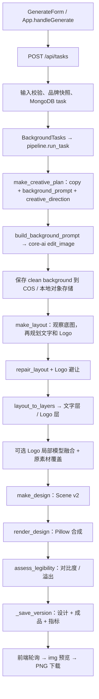
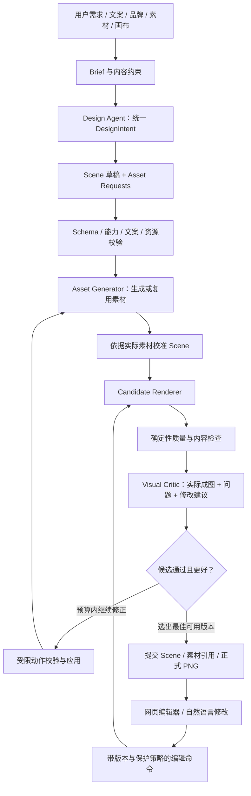

# AI 海报设计 Agent：V2 架构与视觉质量升级设计

> 日期：2026-10-20。状态：设计提案，尚未开始实施。
>
> 分析基线：当前工作区，而不是仅分析 Git 已提交版本（当前 HEAD：`bc24d1f`）。工作区已有 core-ai 迁移、多轮编辑、品牌规范等未提交改动，本设计保留这些成果。
>
> 用户已确认：**质量优先，允许增加必要模型调用与等待时间。**

**目标：**让 Agent 先构思整张作品及可编辑对象，再生成素材、渲染、观察与修正，首轮交付美观且可以继续编辑的海报。

**推荐架构：**保留 React/Vite、FastAPI、MongoDB、COS 和 core-ai 网关；扩展现有设计状态为 Scene v3。先修复创意信息传递和硬编码布局，利用 Pillow 完成小闭环；随后使用 Fabric.js 编辑与渲染，通过后端受控 Chromium 运行同一份渲染代码生成正式 PNG。Pillow 继续负责图像预处理及旧版本渲染。

**本次交付范围：**现状分析、根因、技术选择、数据和接口设计、分阶段实施与验证方案。不修改业务代码，不执行付费生成，不把文档中的建议视为已经实现。

---

## 1. 结论与优先级

当前项目已有可复用的基础：原文和样式可保存的文字层、素材库、品牌快照、精确修改、版本恢复、对象存储、基础质量检查。问题不是“完全没有分层”，也不是“Pillow 天生无法设计海报”。

更直接的瓶颈是：

1. **创意规划没有统领整张作品。**第一次规划主要返回文案和底图 Prompt；布局在底图生成后另做，`creative_direction` 没有继续传入布局和素材生成决策。
2. **程序会主动收回 Agent 的布局自由。**Prompt、品牌指南和 `repair_layout()` 同时要求上标题、下价格；合法但不同的构图可能被替换为固定促销版式。
3. **设计输入和输出在中间环节丢失。**正常任务的品牌快照缺少参考图；模型输出的文字旋转在规范化时丢失。这两点已离线复现。
4. **可表达对象过少。**当前只有背景、文字、Logo；没有普通图片、独立装饰、自由路径和组合。产品、场景与大部分装饰都烘焙进底图。
5. **完成标准只是渲染成功。**现有检查不观察最终合成图，也不会提出或执行审美修正。
6. **交互与导出的演进缺少统一渲染契约。**当前前端仅展示后端 PNG；引入画布后，如果仍让 Pillow 独立计算换行和字体尺寸，就会产生新的不一致。

因此，推荐顺序是：

**恢复完整设计信息 → 解除固定版式 → 统一创意与对象规划 → 增强素材表达 → 小规模视觉闭环 → 同源画布编辑/导出 → 完整审美迭代 → 高级艺术字。**

不要先建设复杂的多 Agent 框架，也不要先重做整个前端或自研字体引擎。

## 2. 分析依据与已验证边界

### 2.1 本次实际检查

- 阅读前后端生成、编辑、渲染、质量检查、品牌、素材、存储和版本代码。
- 对照现有 README、初版设计、实施计划及测试报告；历史 ToAPIs 记录与当前 core-ai 实现分开处理。
- 查看两张已有输出及 SeeJoy 参考图，没有把历史样张当作当前代码刚生成的结果。
- 执行现有后端测试：**94 个测试通过**；执行前端 `npm run build`、`npm run lint`：均通过。
- 使用离线 stub 验证品牌参考图与旋转数据的丢失，未调用外部模型。
- 查询 Fabric、Konva、Playwright 与浏览器字体/CORS 官方文档，为选型提供依据。

上述测试证明现有工程基线可运行，**不证明视觉质量达标**。本次没有重新运行浏览器 E2E、真实网关能力探测或付费生成；透明生图、蒙版编辑、多图一致性、模型视觉审查能力和实际费用仍需阶段实验验证。

### 2.2 当前能力清单

| 能力 | 当前实际状态 | 代码依据 |
|---|---|---|
| 基础技术栈 | React 19 + TypeScript + Vite；Python FastAPI；MongoDB；COS/本地对象存储 | [前端依赖](D:/ai_project/social-media/frontend/package.json)、[后端依赖](D:/ai_project/social-media/backend/requirements.txt) |
| 输入 | 1～4 张商品图、可选 Logo、品牌、Prompt、四种比例；尚不能创建零商品图任务 | [schemas.py:7](D:/ai_project/social-media/backend/app/schemas.py:7) |
| 品牌 | 扫描品牌目录，保存配色、字体映射与文字指南快照 | [brand_style.py:67](D:/ai_project/social-media/backend/app/services/brand_style.py:67) |
| 模型接入 | core-ai 同步图片生成/编辑、JSON 对话；模型名通过配置提供 | [core_ai.py:147](D:/ai_project/social-media/backend/app/services/core_ai.py:147)、[config.py:17](D:/ai_project/social-media/backend/app/config.py:17) |
| 设计状态 | `schema_version=2`，含画布、背景关联和图层列表 | [design.py:200](D:/ai_project/social-media/backend/app/services/design.py:200) |
| 文字 | 原文、字体、字号、颜色、字重、行距、字距、描边、阴影、底板、有限旋转；后端重绘 | [design.py:59](D:/ai_project/social-media/backend/app/services/design.py:59)、[renderer.py:203](D:/ai_project/social-media/backend/app/services/renderer.py:203) |
| Logo | 原素材引用和位置仍在，但默认将局部融合结果写进背景；失败时透明叠加 | [pipeline.py:305](D:/ai_project/social-media/backend/app/services/pipeline.py:305) |
| 普通图片/装饰/组合 | 无对应原生图层类型 | [design.py:268](D:/ai_project/social-media/backend/app/services/design.py:268) |
| 网页编辑 | 侧栏改字、字号、颜色、对齐、文字旋转、显隐、Logo 定位缩放；修改后等待后端 PNG | [LayerPanel.tsx:54](D:/ai_project/social-media/frontend/src/components/LayerPanel.tsx:54) |
| 画布操作 | 边界框可点击选择，但没有拖拽、变换手柄、直接文本编辑和排序操作 | [ResultPanel.tsx:99](D:/ai_project/social-media/frontend/src/components/ResultPanel.tsx:99) |
| 自然语言编辑 | 确定性解析优先，复杂请求调用编辑模型，动作白名单校验后执行 | [editor.py:650](D:/ai_project/social-media/backend/app/services/editor.py:650) |
| 保存和导出 | 每次修改保存设计、输出、质量信息；可恢复旧版本；下载已有 PNG | [pipeline.py:211](D:/ai_project/social-media/backend/app/services/pipeline.py:211)、[tasks.py:402](D:/ai_project/social-media/backend/app/routes/tasks.py:402) |
| 质量检查 | 检查文字区域平均背景对比度、排版溢出指标；没有视觉审美模型闭环 | [quality.py:37](D:/ai_project/social-media/backend/app/services/quality.py:37) |
| 任务执行 | FastAPI `BackgroundTasks`；启动时标记中断任务；不是持久化工作队列 | [tasks.py:171](D:/ai_project/social-media/backend/app/routes/tasks.py:171)、[main.py:25](D:/ai_project/social-media/backend/app/main.py:25) |

**可编辑性的准确表述：**当前文字具备“修改原文后重新绘制”的数据能力，不是只有文字 PNG；但网页没有原生画布文字编辑体验。Logo 具备对象元数据，却不总是独立参与最终合成。两者应分别升级，不能统称为“已经完成编辑器”。

### 2.3 当前首轮调用链



主要入口和顺序见 [App.tsx:466](D:/ai_project/social-media/frontend/src/App.tsx:466)、[tasks.py:101](D:/ai_project/social-media/backend/app/routes/tasks.py:101)、[pipeline.py:514](D:/ai_project/social-media/backend/app/services/pipeline.py:514)。

这里虽然已采用“不含文字的底图 + 独立文字”，但**还没有真正做到在素材生成前规划全部可编辑对象和它们的视觉关系**。

当前编辑链为：

`对话 / 侧栏 → edits / layers API → 获取 edit 锁 → plan_edit / apply_layer_patch → 必要时换底图或重新融合 Logo → Pillow 重绘 → 新版本`。

纯改字不生图的行为应保留。当前“重新排版”直接调用 `promo_layout()` 重建文字层，仍不是 Agent 自由重构，见 [pipeline.py:773](D:/ai_project/social-media/backend/app/services/pipeline.py:773)。

## 3. 根因分析

### 3.1 设计规划：拥有创意字段，但没有连续的设计决策

[make_creative_plan](D:/ai_project/social-media/backend/app/services/designer.py:140) 只产出 `creative_direction/background_prompt/copy`，没有画布输入、完整对象计划、素材清单、空间关系或能力约束。

[run_task](D:/ai_project/social-media/backend/app/services/pipeline.py:584) 只取 `background_prompt` 构建底图请求；[make_layout](D:/ai_project/social-media/backend/app/services/pipeline.py:641) 接收底图、画布、文案、品牌，却没有接收最初的 `creative_direction` 和完整用户设计意图。底图与文字因此容易成为两个独立决定。

建议：把“先抽文案、后找空位叠字”改为“同一 DesignIntent 指导对象、底图、装饰及文字；生成后只校准实际偏差”。

### 3.2 Prompt 与修正规则：固定布局覆盖了自主设计

- [底图 Prompt](D:/ai_project/social-media/backend/app/services/designer.py:296) 固定要求上下留白、右上 Logo 区。
- [布局 Prompt](D:/ai_project/social-media/backend/app/services/designer.py:762) 固定主标题在上、价格在下，并限制字体为 `brush/sans`。
- [repair_layout](D:/ai_project/social-media/backend/app/services/designer.py:558) 当文字最大下边界小于画布高度 70%，或价格 y 小于 55% 时，直接返回固定 `promo_layout`。
- 未提供价格时 `price_y` 默认为 0，仍满足上述替换条件；文字型品牌活动也可能被当作促销模板处理。
- [品牌排版指南](D:/ai_project/social-media/.agents/skills/seejoy-brand-poster/references/layout-guide.md) 也有“价格必须下半部”“细节在底部”等硬性要求。

建议：保留文案准确、资源有效、图层可渲染等硬约束；把配色、字体气质和构图倾向转成可解释的品牌偏好。几何校验只指出问题，不因“不像预设版式”重排。禁止误遮挡，不禁止有意遮挡；允许出血，不允许关键文字意外裁掉。

### 3.3 两个已经复现的数据丢失问题

**问题一：品牌参考图在正常任务路径中丢失。**

品牌加载时有三张 `reference_paths`，但 [snapshot](D:/ai_project/social-media/backend/app/services/brand_style.py:67) 没有保存引用；[brand_from_snapshot](D:/ai_project/social-media/backend/app/services/brand_style.py:282) 也没有恢复图片；[brand_for_task](D:/ai_project/social-media/backend/app/services/brand_style.py:320) 优先返回该快照。于是设计模型中“附加品牌参考图”的分支，在标准新建任务路径中没有图片可附加。

本次离线结果：`loaded_brand_references=3`，`task_snapshot_references=0`。当前测试验证了直接传入完整品牌对象会附图，缺少“创建任务 → 从快照恢复 → 发起模型请求”的覆盖。

修复应保存**版本化素材引用和内容哈希**，不能只补本机绝对路径，也不能每次读取品牌目录最新图片而悄悄改变历史任务。

**问题二：模型生成的旋转角度丢失。**

[布局 Prompt](D:/ai_project/social-media/backend/app/services/designer.py:780) 要求 `rotation`，但 [normalized 字段列表](D:/ai_project/social-media/backend/app/services/designer.py:830) 没有复制该字段；之后会使用修正规则或默认角度。

本次 stub 结果：输入 `rotation=14`，规范化后为 `None`。需要测试完整转换链，不能只测试 Pillow 能否绘制一个手动构造的旋转图层。

### 3.4 素材生成：统一风格输入不完整，独立对象不足

当前图片 API 主要用于完整底图和 Logo 融合。商品图被作为参考图送入模型，没有成为可移动、可替换的产品图层；底图内部的光影、产品和装饰也无法独立处理。

“保持商品外观、数量和摆盘”的 Prompt 是意图，不是像素保真保证。当前 [core_ai.py](D:/ai_project/social-media/backend/app/services/core_ai.py:168) 有 `mask` 请求字段，但仅有请求构造不代表真实网关已验证支持所有蒙版/透明素材能力；现有接口没有专门的透明背景输出选项。

建议：先支持原始商品照片/透明图的独立图层与少量装饰素材，不强制自动抠出所有菜品。Agent 明确选择“场景融合”或“独立对象”，用户要求独立编辑的元素必须进入后者。

### 3.5 图层与文字：能力范围窄，且表达被进一步压缩

- 首轮布局按照固定角色抽取，一个角色只接受一个图层，见 [designer.py:821](D:/ai_project/social-media/backend/app/services/designer.py:821)；标题分段、多个手写批注、数字与单位分组难以表达。
- [layout_to_layers](D:/ai_project/social-media/backend/app/services/designer.py:1038) 用 `text_{role}` 做 ID；[make_design](D:/ai_project/social-media/backend/app/services/design.py:224) 又按数组顺序重写所有 `z_index`，不能保留完整的跨对象层次意图。
- Text 旋转被限为 ±20°，坐标不允许负数；无 group、image、shape、mask、文字渐变或纹理填充。
- 字体仅有 Noto Sans SC 与 Ma Shan Zheng。毛笔字体是静态字体，[renderer.py:66](D:/ai_project/social-media/backend/app/services/renderer.py:66) 直接返回，`font_weight=900` 不会让它拥有真正的另一套粗字形。
- [自动适配](D:/ai_project/social-media/backend/app/services/renderer.py:137) 可缩小到初始字号的 35%，但有效字号只写入渲染指标，原始设计字号不变。前端将来若按原始字号直接绘制，会与现有成品不同。
- 文字初次抽取被 [截断至 120 字](D:/ai_project/social-media/backend/app/services/designer.py:77)；侧栏输入限制为 200 字，后端编辑允许 500 字。信息密集海报需要统一策略，不能无提示截断。

Pillow 目前有价值的能力应保留：确定性字体绘制、中英文换行、基础特效、透明合成、原图处理、输出编码。主要问题是当前上层模型和渲染器实现的范围；Pillow 本身并不等于只能画矩形。

### 3.6 Logo 融合削弱独立编辑

[融合流程](D:/ai_project/social-media/backend/app/services/pipeline.py:305) 裁切底图、调用图片模型、融合回底图、擦除模型 Logo 区域、覆盖原始 Logo；[渲染器](D:/ai_project/social-media/backend/app/services/renderer.py:427) 对 `model_integrated` Logo 跳过独立绘制。

由此产生：

- 原始 Logo 字形可以精确保留，但周围背景可能发生变化。
- 移动/缩放 Logo 可能调用模型，无法成为即时画布操作。
- Logo 在元数据上有层级，视觉上却已经烘焙在文字下面的背景中。
- 原始透明 Logo 不带白底，不等于模型生成的环境一定没有边框、幽灵标记或接缝。

新设计默认使用独立原始 Logo；需要环境融合时，把阴影/光晕作为独立效果层放在 Logo 下方。复杂融合先作为可选能力，不再成为每次生成或移动 Logo 的默认步骤。

### 3.7 缺少最终视觉反馈与内容保护

[quality.assess_legibility](D:/ai_project/social-media/backend/app/services/quality.py:37) 读取底图及文本框平均颜色，不观察完整渲染结果；它无法评估字体气质、拼贴感、装饰过量、层次、重复 Logo 或价格是否与用户输入相符。底图未经统一尺寸变换时，检查坐标还可能与实际合成坐标不一致。

`locked` 也尚未形成“用户修改后禁止 AI 覆盖”的完整服务端策略。尤其重新排版会重建文字层，缺少字段来源和人工保护范围。

版本存储已经存在，可以复用；但 [_render_and_commit](D:/ai_project/social-media/backend/app/services/pipeline.py:454) 当前把渲染、检查、上传、切换正式版本捆在一起，必须先拆开，才能安全生成并淘汰候选。

### 3.8 样张观察，不扩大为未经验证的因果结论

本次查看：

- [方形成品](D:/ai_project/social-media/storage/e2e-core-ai-download.png)：摄影主体清晰；标题主要依赖统一粗描边，价格与 CTA 使用规则标签；右上可见两个相邻的小标记。
- [9:16 成品](D:/ai_project/social-media/storage/e2e-seejoy-9x16-cleaned.png)：纵向摄影完整，信息集中在上下；Logo 周围可见矩形区域和圆形白边。
- [品牌参考图](D:/ai_project/social-media/.agents/skills/seejoy-brand-poster/assets/reference-2.jpg)：分色笔刷标题、云朵优惠徽章、细手写批注、弧形色带、价格数字与单位层级更丰富。

这些观察与代码的表达限制一致，但不能仅凭两张图片证明每个问题的产生阶段；样张对应的底图、对象状态和模型记录仍应在基准集里一一关联。新方案也不以逐像素复制品牌参考为目标。

## 4. 技术方案比较与推荐

### 4.1 三条可行路线

| 路线 | 收益 | 代价与限制 | 判断 |
|---|---|---|---|
| 持续扩展 Pillow，前端保留图片和表单 | 改动最小，容易做设计 Prompt 的对照实验 | 无法满足即时画布编辑；后续仍要解决交互和文本布局一致性 | 适合 Phase 1，不能作为最终形态 |
| **Fabric.js + 同源 Chromium 渲染** | 文本、对象变换、分组等编辑基础较完整；同一 JS 渲染模块用于网页与正式导出 | 增加 Fabric 与 Chromium；需 Scene 适配、中文排版实验和 React 生命周期管理 | **推荐目标路线** |
| React-Konva + 同源 Chromium 渲染 | React 声明式接入自然，绘图及变换自由度高 | 文本编辑需自行接 DOM 输入；复杂选区/分段样式要补更多编辑器逻辑 | Fabric 中文/组合实验不通过时的备选 |

当前前端没有 Fabric/Konva 投资，不能只因 React 就自动选择 Konva。这里优先选择 Fabric，是因为产品已明确要求文本直接编辑和持续扩展设计对象。Fabric 本身不会自动改善审美，创意规划和视觉闭环仍是主要质量来源。

### 4.2 按需求比较渲染技术

| 维度 | 当前 Pillow | Fabric.js | Konva.js | 原生 SVG | 原生 Canvas API |
|---|---|---|---|---|---|
| 中文字体 | 已有两套字体和自定义换行 | WebFont + 文本对象；需验证中文输入、断行、字重 | WebFont + Text；输入编辑需外接 DOM | 字体/字形可表达；多行布局需自己组织 | 字体可用，排版与编辑自行实现 |
| 文字编辑 | 表单提交后端重绘 | IText/Textbox 提供编辑基础 | 官方推荐外部 input/textarea | 需另做输入、选区、文本布局 | 需自行实现 |
| 旋转/复杂变换 | 当前只做基础旋转/缩放 | 对象变换与控制柄 | Transformer 与节点变换 | transform 强，但编辑控制自建 | 绘制强，交互控制自建 |
| 描边/阴影/渐变 | 已有描边阴影；其余需扩展 | 有对应绘图对象/属性 | 有对应绘图属性 | filter/gradient/mask 表达丰富 | 基础绘图能力齐全 |
| 图片混合 | alpha 合成成熟 | 图片、对象、裁剪 | 图片、节点、裁剪 | image + clip/mask | drawImage + 合成操作 |
| 分组/遮挡 | 当前没有 group | Group；需约束局部坐标与缓存 | Group；需保存应用层语义 | g 和绘制顺序清晰 | 自建场景树 |
| 性能 | 每次服务端整图重绘 | 可缓存对象；复杂 mask 大图需实测 | 可缓存/分层；同样需实测 | 复杂滤镜和大量 DOM 需实测 | 可优化，但工程成本最高 |
| PNG 导出 | 当前已实现 | Canvas 原生尺寸/倍率导出 | 支持 pixelRatio 导出 | 需浏览器栅格化或额外转换链 | 可以导出，但缺少完整对象层 |
| 前后端一致性 | 当前只有一个 PNG，无双渲染问题 | 浏览器与服务器共用同一实现可控 | 同左 | 同源 Chromium 可控；换 SVG 引擎仍会分叉 | 同源实现可控 |
| 迁移成本 | 短期最低，长期编辑成本高 | 中等，编辑能力复用最多 | 中等，React 接入好但文字编辑成本更高 | 对艺术效果好，完整编辑器成本较高 | 最高，不推荐自研基础编辑器 |

官方依据：Fabric 提供文本及交互对象能力，见 [Fabric 概览](https://fabricjs.com/?lang=en) 与 [Textbox API](https://www.fabricjs.com/api/classes/textbox/)；Konva 的文本编辑需要 DOM 输入覆盖，见 [Editable Text](https://konvajs.org/docs/sandbox/Editable_Text.html)。Konva 也支持高倍率导出，见 [High Quality Export](https://konvajs.org/docs/data_and_serialization/High-Quality-Export.html)。SVG 支持文字路径，适合作为后续效果素材表达，见 [MDN SVG Text](https://developer.mozilla.org/en-US/docs/Web/SVG/Tutorials/SVG_from_scratch/Texts)。

**选型验证门槛：**使用现有两套字体和同一份小型 Scene，验证中文输入法、混合中英文字、显式换行、负字距、旋转、描边、价格分段样式、嵌套组和 2× 导出。Fabric 版本在实验后锁定；不直接追随浮动最新版。曲线文字、任意 SVG 完整往返、Photoshop 级混合均不作为原生支持承诺。

## 5. 目标架构：一个设计 Agent，少量有边界的工具



图中的修正不意味着每次都生图。修改位置、文字样式、图形和层级仅重新渲染；只有特定素材确需替换时才调用图片模型。

### 5.1 模块职责与现有代码处置

| 模块 | 处理方式 | 具体职责 |
|---|---|---|
| `designer.py` | 扩展并去除固定版式主路径 | 需求理解、DesignIntent、Scene 草稿、素材请求；保留显式故障兜底，不覆盖合法自由构图 |
| `brand_style.py` 与品牌 skill | 保留并完善 | 版本化文字规范、参考图、字体；区分品牌硬约束与构图建议 |
| `core_ai.py` | 保留适配器 | 网关调用、超时/限流、返回解析；补能力探测、usage/请求追踪与透明素材参数适配 |
| `design.py` | 演进为 Scene 校验和变更核心 | 兼容迁移、图层身份、坐标、类型、能力、动作校验、人工保护 |
| `pipeline.py` | 渐进拆分职责 | 编排、检查点、预算、候选选择；拆开候选渲染与正式提交 |
| `renderer.py` | 保留一段时间及旧版路径 | Phase 1 支持有限增量能力；之后保留旧 Scene 和图像预处理，不长期复制新浏览器排版能力 |
| `editor.py` | 保留解析优势，扩展命令 | 既有精准改字；新层类型、分组、排序；只提出动作、不直接覆盖全 Scene |
| `quality.py` | 保留并增强 | 渲染后几何、文字可见性、内容一致性、素材完整性检查 |
| 新 `visual_critic.py` | 新增 | 最终成图审查、问题定位、候选比较；通过命令层修正 |
| 新 `asset_generator.py` | 需要独立素材时新增 | 统一风格的生成请求、复用、透明度验证、来源记录 |
| 新前端 Scene/Fabric 模块 | Phase 2 新增 | Scene 映射、字体加载、对象渲染、交互事件转换、渲染指标 |
| 新 `browser_renderer.py` | Phase 2 新增 | 使用受控 Chromium 执行前端共享渲染入口，返回 PNG 与指标 |
| 素材/版本/COS 服务 | 保留并增强引用管理 | 素材不可变、引用保留、候选关联、输出可追溯 |

模块都是逻辑职责，可以逐步从已有文件中抽取。MVP 不引入 LangGraph、多个自治 Agent、Redis/Celery 或完整插件平台；现有一个 Python 编排器足够验证产品。

### 5.2 DesignIntent：自由创作与稳定执行分开

设计 Agent 输入：

- 完整需求、画布与平台用途。
- 可用原始素材及“必须独立编辑 / 可融入背景”的要求。
- 用户确定文案及价格、时间、地址、品牌等事实来源。
- 品牌文本与参考图，区分硬约束、软偏好。
- **真实可用**的字体清单和 RendererCapabilities。

输出三个相互关联的部分：

1. `design_intent`：视觉叙事、焦点、色彩、字体组合、材质、光照、密度、图文互动方向。
2. `scene_draft`：自由数量/角色的对象、几何、层次、预期遮挡与组合。
3. `asset_requests`：每件素材的用途、尺寸、透明需求、共享风格、参考对象、占位及与其他对象的关系。

Schema 约束“能否执行”，不约束“标题必须在哪”。`role` 用作语义提示，允许自定义和重复；稳定 ID 才是操作对象标识。

同一次设计的所有素材请求携带相同 `intent_id/intent_hash`，并带局部用途；不能仅靠一段通用品牌 Prompt 期待全部素材自然统一。必要时提供低成本的构图草图作为参考，但布局引导图能否被网关有效利用需要实测。

素材返回后，Agent 看到实际图片再校准位置与留白。校准保留初始设计意图，不退回按固定上下区域贴字。

### 5.3 内容准确性从首轮开始保护

现在的编辑器已强调原文，但首轮文案生成和 fallback 仍可能遗漏或泛化业务信息，需要补齐：

- 保存 `brief_snapshot` 与用户明确文案的来源位置；价格、单位、折扣条件、日期、地址、品牌名建立事实约束。
- 明确提供的文案按原文保留；没有提供的数值不能生成。信息不足且影响商业含义时，提示补充，不猜测。
- 不再通过 `[:120]` 等方式静默截断；超长文本拆分或报告排版约束。
- 创意标题可以在授权范围内创作，但不得修改业务事实。
- Text 的 `content` 是实际绘制内容；来源引用用于核对，不另建一份可以独立漂移的渲染文案。
- 用户明确改价后，更新该版本的事实基线与来源记录；视觉修正不得把新价格“纠正”回旧价格。
- 同一信息拆成多个视觉片段时，保留关联与顺序，校验组合后的原文和含义。MVP 优先用文本 runs 表达分色、数字/单位，避免大量逐字对象。
- 自动审美动作默认不能修改事实文字；OCR 仅在后续作为最终像素核验的辅助手段，**不承担拆层架构**。

### 5.4 Asset Generator：把需要编辑的元素真正分开

| 素材 | 默认策略 | 说明 |
|---|---|---|
| 背景/复杂环境 | 一张高质量位图 | 内部光影纹理无需强拆 |
| Logo | 原始素材独立 image 对象 | 保持比例、alpha、字形；移动不生图 |
| 用户要求可替换的商品/人物 | 独立 image 对象 | 优先原始透明图；普通照片可采用照片拼贴，不默认要求抠图 |
| 允许融入场景的商品 | 可进入背景 | 界面明确标注内部元素不可直接移动；后续替换需要重新生成背景 |
| 笔刷/贴纸/纸纹 | 简单形状或独立透明素材 | 有单独对象身份，可独立调整 |
| 特殊艺术字 | 后续的可重新生成素材 | 保存文案与生成参数，不能声称原生文字可编辑 |

如果用户同时要求“原图严格保真、独立对象、自然场景融合”，先采用原图拼贴与独立阴影；需要自动抠图/重建视角时再进入明确的高级能力，不用 Prompt 承诺解决物理上未实现的分离。

图片生成的文字禁止项只针对本次计划中需要独立渲染的文字与 Logo，不把“所有符号必须禁止”扩展为永远不能生成纯装饰线条。背景出现误生成的业务文字、重复标记时必须在审查中发现。

透明素材要检查真实 alpha、有效内容边界和底色残留。网关不支持透明输出时，优先确定性图形/已有素材；不能把棋盘格图片当透明 PNG。Phase 1 不引入未经评估的大型抠图模型。

## 6. Scene v3：在现有设计状态上演进

### 6.1 数据原则

- 继续使用 `task.design` 和版本中的设计快照，不再新建一套并行的“编辑器文档”作为事实来源。
- `schema_version` 从 2 演进到 3；保留熟悉的 `canvas/layers/id/position/size/rotation/z_index/visible/locked` 概念。
- `scene_revision` 表示已提交设计版本，与结构版本、候选编号、Renderer 版本分开。
- 原生业务对象不使用 Fabric 私有 JSON 作为存储契约；Fabric 对象是 Scene 的运行时投影。只从交互事件读取明确字段，不能把 `canvas.toJSON()` 整体写回。
- 顶层 `design_intent` 描述风格与关系，不直接被当作可执行代码。
- 增量能力由 `required_capabilities` 声明。未实现的类型/效果必须拒绝、修复或显式降级，不能静默丢弃。
- 资源上限用于防止异常数据与内存爆炸，不规定作品的固定图层数量或网格。

Fabric 支持对象自定义属性，但业务数据仍应独立于画布实例管理，见 [Objects and custom properties](https://www.fabricjs.com/docs/using-custom-properties/)。这种边界也与 Konva 推荐的应用状态序列化方式一致，见 [Save and Load Best Practices](https://konvajs.org/docs/data_and_serialization/Best_Practices.html)。

### 6.2 核心对象

| 类型 | 数据与编辑含义 | 首次开放阶段 |
|---|---|---|
| `background` | 素材引用、cover/contain、裁剪、颜色；作为基础背景 | 已有，逐步规范 |
| `text` | `content`、font_id、样式、换行/适配策略、可选 runs；可以直接改字 | 已有，Phase 1/2 增强 |
| `image` | asset_id、crop、opacity、变换；role 可为 logo/product/decoration | Phase 1 最小支持 |
| `shape` | 矩形、椭圆、多边形、线；后续增加受限 path 和渐变 | Phase 1 最小支持，Phase 2 扩展 |
| `group` | 子对象关系与统一变换；不重复保存 children 和 parent_id 两套关系 | Phase 2 |

复杂艺术字采用 `image` + `generation.kind="art_text"`，通过 `editability="regenerate"` 明示；无须为了它新增一整套平行的图层系统。

Scene 中普通 Logo 统一为 `image`、`role="logo"`，旧版 `type="logo"` 由迁移适配器读取。`asset_id` 引用不可变素材记录，不保存临时预签名 URL。

### 6.3 示意结构

以下是目标协议示意，字体和素材 ID 均为占位符；不是当前已经支持的可执行样例：

```json
{
  "schema_version": 3,
  "scene_revision": 1,
  "canvas": {
    "width": 1080,
    "height": 1350,
    "color_space": "srgb"
  },
  "renderer": {
    "engine": "browser-fabric",
    "build_id": "renderer-build-id"
  },
  "required_capabilities": ["text.basic", "image.alpha"],
  "design_intent": {
    "id": "intent_01",
    "concept": "以真实菜品与手写笔触构成热闹的门店邀请",
    "palette": ["#0D4317", "#B12310", "#FFF4DF"],
    "typography": "笔刷标题、清晰正文和紧凑价格层级",
    "composition": "由本次需求自由规划，不预设上下区域"
  },
  "layers": [
    {
      "id": "layer_bg_01",
      "type": "background",
      "asset_id": "asset_bg_01",
      "fit": "cover",
      "z_index": 0,
      "visible": true,
      "locked": true
    },
    {
      "id": "layer_title_01",
      "type": "text",
      "role": "headline",
      "name": "主标题",
      "content": "周末相聚",
      "position": {"x": 120, "y": 190},
      "size": {"width": 800, "height": 230},
      "rotation": -7,
      "transform": {"scale_x": 1, "scale_y": 1, "origin_x": 0.5, "origin_y": 0.5},
      "style": {
        "font_id": "font_mashanzheng_pinned",
        "font_size": 160,
        "font_weight": 400,
        "color": "#FFF4DF",
        "line_height": 1.05,
        "letter_spacing": 2,
        "align": "left"
      },
      "text_layout": {"wrap": "cjk", "fit": "none", "overflow": "report"},
      "parent_id": null,
      "z_index": 30,
      "visible": true,
      "locked": false,
      "editability": "native",
      "edit_policy": {"ai_locked": false},
      "provenance": {"created_by": "agent", "source_copy_id": "copy_01"}
    },
    {
      "id": "layer_logo_01",
      "type": "image",
      "role": "logo",
      "asset_id": "asset_original_logo",
      "position": {"x": 850, "y": 65},
      "size": {"width": 140, "height": 100},
      "rotation": 0,
      "opacity": 1,
      "z_index": 40,
      "visible": true,
      "locked": false,
      "editability": "native",
      "edit_policy": {"ai_locked": false}
    }
  ]
}
```

### 6.4 必须写清的渲染语义

1. **坐标：**统一画布设计像素，左上原点，x 向右、y 向下；浏览器缩放仅改变 viewport，不写回 Scene。
2. **旋转：**顺时针角度；旋转中心由 origin 明确。保留现有 `rotation` 字段，避免另一个重复角度字段。
3. **变换顺序：**局部对象先围绕 origin 缩放，再旋转，最后平移；父变换包裹子变换。Phase 2 支持平移、缩放和旋转，skew/任意字形扭曲推迟。
4. **组合：**只用 `parent_id` 建树，禁止环；同级 `z_index` 排序，重复顺序值提交时规范化。组作为连续绘制单元，跨组穿插需要拆组或提升对象，不能假装任意子对象可以跨层混排。
5. **尺寸：**图片框与裁剪明确区分；Text 的框宽控制换行，缩放与重新排版是两种操作。横向拉框改变排版宽度；角部等比缩放通过统一策略更新字号和框尺寸。组缩放保留组变换，避免文本连续反复缩放漂移。
6. **换行：**显式换行优先；中文标点避头尾、英文单词、价格和单位不应被随意拆断；字体测量必须等待字体加载完成。
7. **自动适配：**不允许渲染器秘密缩字。适配器计算后返回 `resolved_layout`；修改字号/框时必须提交明确修正，否则只报告溢出。旧版可保留原有行为。
8. **出血/遮挡：**允许负坐标、旋转和装饰出画布；业务文字必须通过可见性检查。关系中记录有意遮挡，不把所有相交框都当错误。
9. **背景：**v3 以 background 图层为渲染来源。原有顶层 `background.clean_asset_id/render_asset_id` 仅作兼容和生成来源信息，不再作为可独立编辑的第二个来源。
10. **样式：**保留已有 style 结构，逐步加入 fill/gradient/runs。旧 `style.background` 在新版本可迁移为明确 shape 对象；迁移前不能同时绘制底板和 shape 造成重复。

省略的通用变换值统一为：`rotation=0`、`scale_x=scale_y=1`、`origin_x=origin_y=0.5`、`parent_id=null`。边界框仍按旋转前的局部尺寸存储；所有适配器遵循同一默认值，不依赖各渲染库自身的默认 origin。

### 6.5 原生文字与艺术素材的边界

- **原生 text：**改 content 即可重绘；字体、颜色、字距、行距、渐变、描边、阴影和 runs 仍来自结构化数据。
- **确定性艺术效果：**在原文和字体基础上计算纹理 mask、路径或字形效果；只要修改文字能重新计算，就仍可属于可编辑 text 的效果。
- **AI 艺术字图片：**保留原文、提示词、参考素材、模型和种子（仅当实际支持）；改字后必须重新生成。界面显示“需重新生成”，不能替换 content 后继续把旧图当新结果。

第一阶段不要把所有标题改成 AI 文字位图。关键价格、时间、地址、品牌正文必须保留真实文字；特殊艺术标题可后续按需求选择第二或第三种方式。

字体目录建立 `font_id → 文件 hash/字重范围/字形覆盖/许可证/可用于 Web 嵌入` 的清单。当前 Ma Shan Zheng 有随仓库提供的 OFL 文件；Noto 字体的分发许可文件及具体文件来源还需补核。缺字应提示或选择明确的可用字体，不能静默依赖用户电脑的系统字体。

## 7. 编辑、预览和正式导出的统一

### 7.1 同一份 Scene，同一套渲染实现

建议新增共享前端模块，其责任只包括资源加载、Scene 到 Fabric 对象映射、文字布局和导出，不依赖聊天面板等业务 UI：

```text
Scene + 字体/图片资源清单
        │
        └── frontend/src/scene/renderScene.ts
                 ├── 浏览器 Canvas：交互预览
                 └── 受控 Chromium StaticCanvas：候选图 / 正式 PNG
```

后端通过 Python Playwright 调用仅供渲染的页面入口；生产环境加载构建后的静态 bundle，不依赖 Vite 开发服务器，不必新增一个完整 Node 后端。

约定：

1. 前端画布和无界面渲染页使用同一 renderer build、Scene 解释逻辑和字体文件。
2. 渲染前等待声明的字体、所有图片解码及资源校验完成；随后返回 `ready`，不能以任意固定 sleep 代表加载完成。
3. 预览使用设计像素的 viewport 缩放；导出使用原始画布尺寸与明确倍率。关闭选择框、参考线、光标等编辑辅助元素。
4. 正式 PNG 从 Canvas 导出，不能截取网页上缩小后的预览图。Playwright 用于执行相同页面和回归验证，而不是用整页截图替代作品导出。
5. 默认导出设计原始尺寸，可提供 2×；放大位图背景不会增加真实细节，必要时先生成更高分辨率背景。
6. 记录 renderer build、Chromium 版本、字体 hash、导出倍率和色彩空间。相同固定运行环境应可复现；跨操作系统/浏览器只承诺经验证的视觉一致性，不承诺任意环境逐像素一致。
7. 渲染器同时返回文本实际边界、行数、字号、变换后边界及对象可见性，供 QA 和 Critic 使用。

浏览器字体可通过 [FontFaceSet.ready](https://developer.mozilla.org/en-US/docs/Web/API/FontFaceSet/ready) 等待加载；后台可通过 [Playwright page.evaluate](https://playwright.dev/docs/api/class-page#page-evaluate) 执行共享渲染入口。Fabric 的 [StaticCanvas API](https://www.fabricjs.com/api/classes/staticcanvas/) 提供非交互画布与导出能力。

**Pillow 的长期边界：**EXIF 处理、缩放裁切、透明通道校验、缩略图、图像差异检查、原素材处理以及旧版渲染。新 Scene 不再同时维护一套独立 Pillow 字体布局实现。

### 7.2 接入 Canvas 前必须处理的资源问题

现在素材接口对 COS 返回 302 预签名 URL，见 [assets.py:80](D:/ai_project/social-media/backend/app/routes/assets.py:80)。普通 `` 能展示，不代表 Canvas 能导出。

推荐新增同源资源字节接口：按受信任 `asset_id` 读取对象存储并返回图片字节，设置缓存/ETag；**不能仍然 302 跳转到没有配置 CORS 的 COS URL**。字体也使用版本化同源资源。这样浏览器编辑器和后端渲染页都只加载声明过的资源。

替代方案是配置 COS CORS 并正确使用 `crossOrigin`，但需要把预签名过期和跨域条件一起验证。相关限制见 [MDN Canvas 跨域图片](https://developer.mozilla.org/en-US/docs/Web/HTML/How_to/CORS_enabled_image)。

Scene 不允许任意外部 URL、任意 HTML/JS。后续 SVG/path 采用受限指令和经过校验的素材；不执行模型返回的脚本、事件属性或任意网络引用。

### 7.3 编辑器交互与状态

保持当前 App、素材库、聊天和版本面板布局，主要替换成品预览区域并扩展 LayerPanel：

- 选择、拖动、变换手柄、旋转；支持图层顺序与显隐。
- 双击文本进入真实输入；中文输入法 composition 过程中不发保存、不截断输入。
- 字体、字号、颜色、描边、阴影等属性面板；支持粘贴多行文字。
- 替换背景、Logo、商品图；替换时保持框/裁剪可控。
- 分组、解组、统一移动/缩放/旋转；嵌套选择逐步开放。
- 本地撤销/重做与明确的未保存状态。
- 手势中只更新本地草稿，结束时提交一个命令批次；不要把每个 pointermove 发送到后端并生成版本。

React 保管已提交 Scene、草稿和选择状态；Fabric 实例由明确的生命周期管理，事件只转换成业务命令。首版可用 `useReducer` 与有限命令历史，不必立即引入大型状态库。

服务器仍是正式版本的权威。浏览器草稿可以即时预览；正式下载绑定已保存 revision。保存失败显示未保存状态并保留草稿，不能让“已保存”指向未成功渲染的成品。

### 7.4 接口演进

保留现有创建、获取任务、版本列表、下载和自然语言编辑 API。现有单层 PATCH 继续服务旧界面，新界面增加批量命令：

| 接口建议 | 用途 |
|---|---|
| `GET /api/tasks/{id}` | 沿用；附带 Scene revision、renderer 信息、生成/审查状态 |
| `POST /api/tasks/{id}/commands` | 提交一组文字、变换、排序、分组、替换素材命令 |
| `POST /api/tasks/{id}/edits` | 沿用自然语言入口，增加 base revision 与允许修改范围 |
| `POST /api/tasks/{id}/optimize` | 用户主动再次审美优化；指定目标图层、保护范围与预算 |
| `GET /api/assets/{id}/content` | 新同源字节接口；提供图片/纹理等可缓存资源 |
| `GET /api/fonts` | 返回可用字体、能力、授权信息与版本化文件地址 |
| `GET /api/tasks/{id}/download?version=n` | 沿用，返回该正式版本的已渲染 PNG |

命令示例：

```json
{
  "base_revision": 7,
  "request_id": "client-generated-id",
  "commands": [
    {
      "type": "update_text",
      "layer_id": "layer_price_01",
      "content": "¥169起"
    },
    {
      "type": "move_layer",
      "layer_id": "layer_price_01",
      "position": {"x": 620, "y": 880}
    }
  ]
}
```

命令类型扩展现有 `editor.py`，增加 `reorder_layer/group_layers/ungroup_layers/replace_asset` 等；不使用任意 JSON 路径写操作绕过校验。用户操作和 AI 操作使用同一执行器，但服务端确定不同权限范围，不能由请求体自行声称“这是用户操作”。

沿用现有单任务编辑锁，再增加 `base_revision` 比较和 `request_id` 去重；不一致返回 409，提供最新版本。已有 `current_version` 与新 `scene_revision` 规定为同一正式版本号的 API 投影，禁止各自递增。

## 8. Visual Critic 与有边界的自动优化

### 8.1 输入必须是实际渲染结果

Critic 接收：

- 候选实际 PNG，必要时附标题/价格等局部高分辨率裁切。
- 当前 Scene 的对象摘要及 layer_id 映射。
- DesignIntent、品牌规范和风格参考。
- 关键业务事实、人工保护图层、已经使用的预算。
- 确定性 QA 结果。
- 上一个最佳候选，用于判断当前变化是否改善，而非只看独立总分。

不要只把 Scene JSON 发给模型，然后让模型猜测海报是否美观。带编号的辅助图可用于定位，但审美评估必须同时看到没有标记覆盖的成图。

### 8.2 两道检查，分别负责正确性与审美

**确定性检查：**

- 结构可解析、资源/字体存在、字形覆盖、画布尺寸正确。
- 关键原文存在，价格、日期、单位和限定条件未被擅改。
- 关键文本未被裁切、隐藏或严重遮挡；实际字号与可读性满足约束。
- 用户保护对象没有被直接或间接修改。
- 生成结果引用完整，图片 alpha 与裁剪有效。

几何只是辅助：旋转后的文字需使用真实变换边界或 mask；有意图文穿插不能被简单的矩形相交算法一律判错。

**视觉检查：**

- 构图和主次，阅读顺序，字体风格匹配。
- 背景与文字/装饰的色彩、光照、材质和尺度协调。
- 机械贴图感、装饰密度、重复标记、局部接缝、信息竞争。
- 业务信息在最终像素中是否清晰；必要时要求人工确认模型无法可靠判断的细节。

分数用于比较和趋势观察，不承担事实校验，也不单独决定是否覆盖旧候选。

### 8.3 可执行输出

```json
{
  "candidate_id": "candidate_02",
  "issues": [
    {
      "id": "issue_01",
      "severity": "major",
      "category": "hierarchy",
      "layer_ids": ["layer_price_01"],
      "evidence": "价格数字与辅助标签接近同等大小，第一视线被辅助标签吸引",
      "intent": "增强价格层级，同时保留原文",
      "suggested_actions": [
        {
          "type": "update_text_style",
          "layer_id": "layer_price_01",
          "style": {"font_size": 104}
        }
      ]
    }
  ],
  "comparison": {
    "preferred_candidate_id": "candidate_02",
    "confidence": 0.72,
    "reason": "主标题和菜品的层次更清楚，但价格仍有改进空间"
  }
}
```

执行器检查 layer_id、能力、内容保护、影响范围、成本预算，再在候选分支执行。涉及重新组织整张构图的建议交回 Design Agent；Critic 不直接写数据库，也不凭空引用不存在的素材。

### 8.4 质量优先的建议默认预算

以下是**待实际耗时/费用数据校准的初始工程配置**，不是价格或性能承诺：

| 项目 | 建议默认值 |
|---|---|
| 首次设计 | 1 次统一规划；素材返回后按需 1 次布局校准 |
| 初稿检查 | 1 次完整视觉审查 |
| 自动修正 | 默认最多 2 轮；可配置硬上限 3 轮 |
| 候选数 | 默认初稿 + 2 次修正，共最多 3 个；硬上限 4 个 |
| 每轮修改 | 优先处理 1～3 个高影响问题，不每轮全面推翻 |
| 图片调用 | 默认整个任务最多 5 次，包含初始素材、替换和重试；不因多图层而一层一调用 |
| 文本/视觉调用 | 默认任务最多 8 次，包含校准、JSON 修复和审查；达到上限停止 |
| 耗时 | 建议任务预算 900 秒，作为截止控制；每次调用超时取剩余预算与单次上限的较小值 |
| 金额 | 网关计价未核验前只记录可获得的 usage 与调用数，不伪造美元/人民币估算；获取真实费率后增加金额上限 |

若首稿已达标，可提前停止；“质量优先”不是强制用满全部预算，也不是默认并行生成多张昂贵整图。

停止条件：

- 无必须修正的问题，或比较没有足够证据说明可继续提升。
- 达到调用、轮次、耗时或后续配置的金额预算。
- 连续修正没有改善，或最近修正降低质量。
- 必要模型/素材能力不可用，或者继续执行会触碰用户保护范围。

每个候选先通过硬性校验，再按有证据的成对比较更新 `best_candidate`。低置信度时保留当前最佳；出现事实错误/缺素材的候选不得胜出。若新候选更差，继续保留此前结果；若没有任何硬校验合格候选，返回可查看草稿与明确问题，不标记“合格成品”。

### 8.5 版本与候选分离

把当前 `_render_and_commit()` 拆为：

1. `render_candidate(scene)`：输出 PNG、metrics 与确定性 QA。
2. `review_candidate(...)`：保存审查和改动建议。
3. `select_candidate(...)`：选择满足约束的最佳结果。
4. `commit_version(...)`：一次性发布选中的 Scene 和成品关联。

候选记录包含 `task_id/run_id/base_revision/candidate_id/parent_candidate_id/scene_hash/output_asset_id/metrics/review/actions/model_calls`。图片与 Scene 都保存，不能只有分数。

用户版本与内部候选分开：首次生成结束只发布一个正式 v1，内部迭代不挤占当前 `max_versions=40` 的用户历史额度；诊断界面可查看候选及回退原因。之后用户每次完整操作提交一个正式版本。

## 9. 人工修改保护、存储与可靠性

### 9.1 人工编辑优先

- 用户直接编辑某图层后，默认对该图层设置 `edit_policy.ai_locked=true`，并记录修改来源和 revision。
- UI 锁定用于避免拖动误操作；AI 保护用于禁止自动修改，二者分别显示和校验。
- 自动优化可以修改未保护层。用户明确选择“优化这层”才临时授权指定范围；不把“整张更好看”自动解释为解锁所有人工修改。
- 禁止通过移动父组、改组透明度、换 mask 或删除父对象间接改变被保护子对象。
- 新增遮挡层覆盖保护文字、替换背景导致受保护内容失去可读性，也需要影响检查。
- Critic 发现保护层存在问题时输出建议；若超出授权范围，不自动应用。
- 首轮生成没有用户草稿时可全局优化；后续编辑不默认跑全局重排。

### 9.2 并发与提交

保留当前一次一个编辑任务的设计，避免过早引入协同编辑。草稿修改与长时间 AI 优化仍可能相遇，因此必须：

1. AI 从 `base_revision` 创建候选。
2. 提交时再次校验最新 revision 和保护策略。
3. 版本已变化则保留候选供查看，拒绝覆盖，不自动全量替换用户设计。
4. 为正式版本建立 `(task_id, version)` 唯一索引，为请求建立幂等标识。

当前 Docker 配置是单实例 MongoDB，不直接假设可用多文档事务。可先写不可变候选/待提交版本与输出，再用任务文档上的条件更新原子切换“当前版本”指针；提交成功后标记版本已发布。历史列表仅显示已发布版本。失败的待提交记录可恢复核对，不能暴露半提交结果。

### 9.3 素材生命周期

现在 [delete_asset](D:/ai_project/social-media/backend/app/routes/assets.py:100) 会删除素材记录及 COS 对象，可能影响旧任务重开和重新渲染。增加普通图片/字体后这个问题更加明显，必须与编辑器一起处理：

- 素材内容不可变；替换生成新的 asset_id/object key，不覆盖旧对象。
- Scene、版本、候选和生成记录都引用对应素材 ID；记录内容 hash、尺寸、透明度、来源和生成参数。
- 被正式版本引用的素材只从资产库隐藏，不立即物理删除。
- 清理仅针对无引用、超出保留期的候选及孤立对象；失败候选保留期限可配置。
- 字体与品牌参考图也需要版本化。历史成品能下载，不代表历史设计一定能重绘，两个验收项分别检查。

建议的完整追溯关系：

`task → generation run → candidate → Scene hash → asset/font hashes → renderer build → output PNG → published version`。

### 9.4 缓存、重试与恢复

- 渲染缓存键：Scene 内容 hash + renderer build + 字体/素材 hash + 导出参数。
- 生成素材缓存键：模型/可获得的模型版本、规范化 Prompt、DesignIntent hash、参考素材 hash、尺寸、质量、透明/蒙版参数。只复用完全匹配且已验证的资产。
- 当前已有干净底图检查点，继续扩展到规划、每件素材、渲染和审查；恢复从最近完整检查点继续。
- 429 等明确可重试错误采用有上限退避，计入预算。
- **同步生图超时表示结果未知。**保留 [core_ai.py:75](D:/ai_project/social-media/backend/app/services/core_ai.py:75) 的谨慎行为；没有网关幂等/请求查询能力时，不盲目自动重发付费生图。保存已有候选并告知状态。
- 无效 JSON 可给结构化错误做一次修复；不把缺失业务信息替换成“欢迎到店”后假装完整成功。
- 记录每阶段耗时、请求 ID、模型、token/图片调用数与错误；不记录密钥或完整 base64 图片到普通日志。

MVP 保持单实例、单 Uvicorn worker 和有界任务/浏览器并发；Chromium 使用隔离页面、超时与内存限制，复用浏览器进程，任务结束释放页面。长任务从检查点恢复。若需要多实例或服务重启后自动接续，再引入持久队列和租约，不能直接横向扩展当前 `mark_interrupted()` 模式。

### 9.5 旧版兼容

- 旧 Scene v2 和历史输出原样保留，继续可以下载/恢复；不批量重写数据库。
- v2 → v3 是显式适配，保留已有 id、原文、素材和旧数据来源；`brush/sans` 映射到固定字体版本。
- 旧 integrated Logo 需从 `clean_asset_id` 与原始 Logo 重新组合，可能与旧融合光影不同。升级编辑前展示迁移预览；不能凭空从合成底图恢复所有独立对象。
- 原产品已烘焙进背景的旧海报，迁移不会自动获得独立商品层。
- 旧 Pillow 的缩字、旋转裁切和基线可能与 Fabric 不同；以旧 PNG 保留原貌，新编辑版本按新渲染协议生成，差异要可见。
- 某新 Scene 需要浏览器专属效果时，Chromium 失败应保留旧正式版本并报告渲染失败；**不静默切回 Pillow 导出一个不同样式的成品**。

## 10. 分阶段 MVP 实施计划

每个阶段都以实际渲染与编辑证据验收。以下新增文件是建议位置，实施时遵循现有职责边界；不为了文件列表机械拆分。

### Phase 0：固定基线与能力实验

**改动范围**

- 保存 5 类代表需求、准确文案、素材与尺寸，关联现有输出、Scene、字体和模型配置。
- 增加品牌快照完整链路、旋转规范化、非促销布局保留的回归案例。
- 实测网关：视觉输入、透明输出、mask、支持尺寸与费用记录；每类最小调用，不重复全量生成。
- 实现一次 Fabric 渲染实验，不接管主页面，验证第 4 节选择门槛。

**涉及位置**

- 修改：[test_brands.py](D:/ai_project/social-media/backend/tests/test_brands.py)、[test_designer.py](D:/ai_project/social-media/backend/tests/test_designer.py)、[test_pipeline.py](D:/ai_project/social-media/backend/tests/test_pipeline.py)。
- 建议新增：`D:/ai_project/social-media/backend/tests/fixtures/poster_benchmarks/`、`D:/ai_project/social-media/backend/scripts/evaluate_posters.py`。
- 前端实验文件放在 `D:/ai_project/social-media/frontend/src/scene/`，通过独立入口验证，随后复用。

**验证与产出**

- 每个案例有可复用输入、输出和事实清单；离线测试默认不调用真实模型。
- 明确 Fabric/Chromium、字体和图片网关能力，不把营销描述当接口契约。
- 输出基线报告；本次发现的问题先有针对性回归，再修复。

**风险：**当前样张和代码版本不完全一一对应；先把它们标为历史观察，再新增可追溯基线。真实能力实验会产生费用，属于实施阶段，不在本次文档工作中执行。

### Phase 1A：解除创作限制，修复设计信息链路

**具体改动**

1. 修复品牌快照参考图引用，保留 content hash；覆盖完整新建任务路径。
2. 修复 rotation 丢失，测试 Prompt → 规范化 → 图层 → 实际渲染。
3. `repair_layout` 只做合法性和明确错误处理；移除价格位置、用满纵向空间等模板替换条件。
4. 更新品牌指南，把固定布局降为可选示例；保留品牌身份、准确文案等必要约束。
5. Creative Plan 接收画布、完整 brief、能力清单；产出共享 DesignIntent 和初始对象计划，在生图前完成整体构思。
6. 背景 Prompt 使用该次方案规划的空间关系；布局校准接收同一 DesignIntent，停止丢弃上游创意。
7. 首轮图层使用稳定 ID，角色可重复；保留模型给出的顺序和旋转，修复角色唯一、顺序重写等压缩表达。
8. 精确文案贯穿首轮，删除静默截断与错误替换。

**涉及模块**

[designer.py](D:/ai_project/social-media/backend/app/services/designer.py)、[design.py](D:/ai_project/social-media/backend/app/services/design.py)、[brand_style.py](D:/ai_project/social-media/backend/app/services/brand_style.py)、[pipeline.py](D:/ai_project/social-media/backend/app/services/pipeline.py)、[editor.py](D:/ai_project/social-media/backend/app/services/editor.py)、[品牌指南](D:/ai_project/social-media/.agents/skills/seejoy-brand-poster/references/layout-guide.md)、[背景指南](D:/ai_project/social-media/.agents/skills/seejoy-brand-poster/references/background-guide.md)。

**预期效果**

在同一现有渲染器上，保留 Agent 的合法构图；支持侧标题、居中标题、斜向组合和多个同类文字对象。修复参考输入后，模型实际拥有品牌图像依据。

**验证**

- 固定旧背景，只比较旧规划与新规划，隔离生图随机性。
- 五类样例至少各一张，其中无价格品牌活动和侧标题样例不能被转成促销模板。
- 关键业务文字逐项核对；人工评价构图改善，记录不改善的案例。
- 修改标题不生图；改非目标层的情况作为失败。

**风险**

解除模板兜底后，模型有机会暴露真正的排版错误。通过结构校验、明确错误反馈和有限修复处理；不得为了通过测试重新加回统一模板。现有测试中“必须变成下方价格模板”的断言需要改成行为约束。

### Phase 1B：最小表达升级与视觉反馈闭环

**具体改动**

1. 落地 Scene v3 最小契约、v2 适配与 RendererCapabilities。
2. Pillow 暂时只增加必要的 `image`、简单 `shape`（线、多边形、椭圆）合成；不在 Python 中重做完整 SVG、嵌套组和艺术字引擎。
3. 将 Logo 默认为独立 image；支持已有透明装饰和独立产品照片；每张图按设计实际需要组合，不强制配满装饰。
4. 生成/复用素材统一携带 DesignIntent；验证透明度与边缘。
5. 拆开 `render_candidate` 和 `commit_version`。
6. 接入 Critic 最小版：初稿审查 → 最多一次受限修正 → 重绘/复查 → 保留最佳；首先验证循环是否真的改善作品。
7. 加入基础人工保护、资产引用保护和候选元数据，避免后续返工。

**涉及模块**

- 修改现有 [renderer.py](D:/ai_project/social-media/backend/app/services/renderer.py)、[quality.py](D:/ai_project/social-media/backend/app/services/quality.py)、[pipeline.py](D:/ai_project/social-media/backend/app/services/pipeline.py)、[core_ai.py](D:/ai_project/social-media/backend/app/services/core_ai.py)、[assets.py](D:/ai_project/social-media/backend/app/routes/assets.py)。
- 建议新增 `D:/ai_project/social-media/backend/app/services/asset_generator.py`、`D:/ai_project/social-media/backend/app/services/visual_critic.py`。
- 对应测试增加素材失败、错误动作拒绝、最佳候选回退、Logo 移动零生图等用例。

**预期效果**

能出现真正独立的笔刷/贴纸/产品对象，而不全靠文字矩形底板；Agent 第一次看到自己合成的完整海报并修正具体问题。

**验证**

- 展示“旧结果 / 新初稿 / 修正候选 / 最终选中”的对比及问题记录。
- 在五类样例中至少三个获得人工偏好改善，所有样例业务文字保持准确；此门槛是建议，不是已测结果。
- 失败素材不覆盖已可用版本；Critic 改坏时回退；未授权字段不能改变。
- Phase 1 渲染能力清单不允许模型输出尚未实现的 group/filter。

**风险与顺序说明**

Pillow 仍限制效果上限，所以这一阶段只验证“自由设计 + 独立素材 + 反馈”是否带来增益。把最小 Critic 提前到 Phase 1，是为了尽早验证核心价值；完整质量预算和多轮调度仍放在 Phase 3。

### Phase 2A：共享浏览器渲染与原生文字

**具体改动**

1. 实现 Scene → Fabric 映射和字体注册/加载；v3 内容不依赖 Fabric 私有 JSON。
2. 实现普通文字、图片、基础图形、透明度、变换、层级、group；增量加入原生支持范围内的渐变和文本 runs。
3. 建立同源素材/字体字节接口。
4. 新建渲染页入口和 Python Chromium 调用，返回 PNG 与 resolved metrics。
5. 新 Scene 使用 browser renderer；旧 Scene 保留 Pillow。

**涉及位置**

- 建议新增 `D:/ai_project/social-media/frontend/src/scene/types.ts`、`D:/ai_project/social-media/frontend/src/scene/renderScene.ts`、`D:/ai_project/social-media/frontend/src/scene/fonts.ts`。
- 建议新增 `D:/ai_project/social-media/frontend/src/render-entry.ts` 及对应构建入口，调整 [vite.config.ts](D:/ai_project/social-media/frontend/vite.config.ts)。
- 建议新增 `D:/ai_project/social-media/backend/app/services/browser_renderer.py`、字体资源路由；修改 [main.py](D:/ai_project/social-media/backend/app/main.py)、[requirements.txt](D:/ai_project/social-media/backend/requirements.txt)、[package.json](D:/ai_project/social-media/frontend/package.json)。

**验证**

中文、中英混排、标点、价格、换行、字距、描边、透明图、旋转、嵌套组的黄金样例；浏览器预览与正式导出同尺寸比较；字体缺失/资源未加载必须失败或明确报告，不能悄悄替代。

**风险**

字体测量、group 局部坐标和 Fabric 缓存可能造成差异。先完成小样例与目标平台验证，再将新渲染器作为默认。依赖固定版本与构建产物作为渲染环境的一部分发布。

### Phase 2B：网页编辑、保存和导出闭环

**具体改动**

1. 新增画布组件替换新 Scene 的 `` 预览，保留旧版本图片预览。
2. 实现第 7.3 节交互、图层排序、图片替换、分组、撤销/重做。
3. 批量命令 API、base revision、幂等提交、人工保护策略落地。
4. 手势结束保存，后台正式渲染；输出绑定保存后的版本。
5. 刷新重开、版本恢复、素材引用保留和失败恢复完成联调。
6. 任务创建支持零商品图的品牌/纯文字海报；有素材时仍沿用现有选择流程。

**涉及位置**

- 建议新增 `D:/ai_project/social-media/frontend/src/components/PosterCanvas.tsx`、`D:/ai_project/social-media/frontend/src/scene/commands.ts`、`D:/ai_project/social-media/frontend/src/scene/useSceneEditor.ts`。
- 修改 [App.tsx](D:/ai_project/social-media/frontend/src/App.tsx)、[ResultPanel.tsx](D:/ai_project/social-media/frontend/src/components/ResultPanel.tsx)、[LayerPanel.tsx](D:/ai_project/social-media/frontend/src/components/LayerPanel.tsx)、[GenerateForm.tsx](D:/ai_project/social-media/frontend/src/components/GenerateForm.tsx)、[types.ts](D:/ai_project/social-media/frontend/src/types.ts)、[api.ts](D:/ai_project/social-media/frontend/src/api.ts)。
- 修改 [tasks.py](D:/ai_project/social-media/backend/app/routes/tasks.py)、[schemas.py](D:/ai_project/social-media/backend/app/schemas.py)、[editor.py](D:/ai_project/social-media/backend/app/services/editor.py)、[pipeline.py](D:/ai_project/social-media/backend/app/services/pipeline.py)。

**预期效果与验证**

用户可直接改文字、拖动、缩放、旋转、排序、替换素材、保存重开、恢复版本、导出 PNG。端到端测试必须包含中文输入法与连续编辑，不仅调用 API；修改普通文本和移动 Logo 均不调用图片模型。

**风险**

旧 v2 与新 v3 的显示差异、草稿/正式结果混淆、父组变化绕过保护、CORS、过期资源 URL。以版本绑定、明确保存状态和共享命令执行器处理。

### Phase 3：完整审美迭代与质量优先调度

**具体改动**

- Critic 切换到共享浏览器渲染产物。
- 开放默认两轮、最大三轮修正，成对比较和最佳候选回退。
- 允许有预算的单件素材重新生成，保留未改对象。
- 自然语言主动“优化”接受目标范围；默认保护人工编辑。
- 完善调用/时间/金额预算、检查点、失败状态、审查记录和候选诊断。

**涉及模块**

`visual_critic.py`、`asset_generator.py`、[pipeline.py](D:/ai_project/social-media/backend/app/services/pipeline.py)、[quality.py](D:/ai_project/social-media/backend/app/services/quality.py)、[config.py](D:/ai_project/social-media/backend/app/config.py)、任务状态与版本 UI。

**验证**

预设低对比、文字挡住价格、重复装饰、缺失素材等案例；检查能否定位 layer_id、执行正确修正、避免无限循环。加入“第二轮更差”“模型不可用”“超时结果未知”“用户在 AI 运行中修改”的失败路径。

**风险**

模型主观评分漂移及无效微调。用硬校验、与最佳候选比较、低置信度保守保留、人工盲评校准控制；不靠增加循环次数掩盖设计能力不足。

### Phase 4：高级艺术文字与复杂效果

按前面基准集中最影响质量的缺口逐项增加：

- 字体轮廓/路径效果、受限形变、文字纹理 mask。
- 独立纹理、笔刷边缘、局部遮挡与更丰富混合。
- 可重新生成的艺术标题及局部素材更新。
- 更复杂的商品分离/蒙版编辑，前提是已验证网关或工具能力。

每项效果都声明支持的 renderer、编辑模式、重新生成成本和兼容方式；不作为 MVP 前置条件。

### 阶段依赖与最小首批开发包

```text
Phase 0
  → Phase 1A
  → Phase 1B（第一个可证明质量改善的小闭环）
  → Phase 2A
  → Phase 2B（完整编辑 MVP）
  → Phase 3（质量优先自动优化 MVP）
  → Phase 4（按真实需求选择）
```

**最先实施的建议包：**品牌参考图快照修复、rotation 修复、取消强制促销重排、传递 DesignIntent、固定背景对照实验。这些改动范围小，可以先确认方向是否有效，再投入编辑器迁移。

## 11. 质量与编辑能力的验收方案

### 11.1 基准集

至少覆盖以下五类，每类准备两个差异明显的 brief/尺寸，形成 10 个基础案例；完整流水线稳定后再对有随机性的案例做重复采样：

| 类别 | 主要检验点 |
|---|---|
| 餐饮促销 | 食物摄影、价格与优惠层级、风格统一 |
| 品牌活动 | 无价格也能自由构图；Logo 和品牌身份 |
| 信息密集 | 长中文/英文地址、日期、条件、多行阅读顺序 |
| 强艺术排版 | 旋转、分色/分段、笔刷、非规则构图与有意遮挡 |
| Logo + 商品图 | 原始 Logo 保真、商品独立对象、替换和保存恢复 |

覆盖 1:1、9:16、4:5、16:9，至少一个无商品图案例。测试文案中的数字属于固定 fixture，不从品牌参考图片中抄取。

比较两种实验：

1. **固定背景实验：**相同背景与原文，对比旧布局/新布局/Critic 修正，定位设计与渲染提升。
2. **完整链路实验：**相同用户 brief、素材、品牌和模型设置，对比旧系统、新系统；增加整图生图作为视觉上限参考。整图样张不计入“可编辑性”成绩，也不要求分层结果复刻其像素。

记录模型标识、参数、随机种子（如果支持）、Prompt 版本、Scene、字体、renderer 和素材 hash。模型非确定时不能宣称只固定 seed 就能保证完全重现。

### 11.2 视觉质量与编辑能力分别评分

**视觉质量**

- 整体美感、构图、信息层级、字体表现、风格统一、图文融合、机械拼贴感。
- 视觉模型给出问题与证据；人工对随机顺序的 A/B 结果做盲评。
- 建议 MVP 门槛：新系统在不少于 10 组配对案例中的人工偏好率达到 70%，且没有某一类场景系统性退步；样本较小，只作为阶段门槛，不宣称统计显著。
- 原文错误、价格/日期遗漏、Logo 错误单独判失败，不能用更高的美感分抵消。

**编辑能力**

- 关键业务文字原生可编辑率 100%；要求独立编辑的 Logo/图片/装饰独立对象覆盖率 100%。
- 不用简单的“可编辑层数/总层数”奖励无意义拆层；按用户实际需要编辑的对象计数。
- 文本修改后精确一致，无后台改写；相关目标以外的 Scene 字段不变。
- 普通文字修改、图层变换、Logo 移动的图片模型调用数为 0。
- 修改并保存后刷新重开，原文、字体、层级、变换与素材引用一致；恢复历史版本可重新导出。
- 人工保护、并发冲突、失败恢复和素材隐藏后历史可用性通过。

### 11.3 渲染一致性与性能

- 固定 Chromium、字体和资源，比较编辑器隐藏辅助 UI 后的作品 Canvas 与后台输出。
- 文案、换行、字体选择和几何布局必须一致；固定环境重复渲染应一致，抗锯齿容差由字体黄金样例校准，不能使用宽松阈值掩盖移位。
- 旋转文本边界、复杂遮挡和长文案必须人工查看，不只检查 PNG 尺寸。
- 验证原始尺寸与 2× PNG、透明边缘、色彩空间、资源失效以及大图内存峰值。
- 以 50 个对象的典型海报做交互基准，目标桌面浏览器拖动帧时间 p95 小于 33ms；这是待实测目标。记录测试硬件和浏览器，复杂效果另设容量限制。
- 记录首轮耗时、每阶段延迟、图片/文本调用数与用户修改保存延迟，再调整默认预算；不把整个生成流程的固定百分比当作真实剩余时间预测。

### 11.4 测试层次与命令

**保留并更新现有后端测试**，重点增加契约和不变量：

- 创意字段/参考图片/角度在整条链路中保留。
- 无价格、同角色多层、自由布局不被模板替换。
- schema 迁移、未知效果拒绝、字体和素材缺失、真实 alpha。
- Critic 错误动作拒绝、内容不可篡改、保护对象及其父组不被覆盖。
- 候选劣化回退、预算停止、幂等、base revision 冲突和发布一致性。

**新增必要的前端单元与浏览器测试：**Scene 映射、命令应用、变换/分组往返、文本输入、保存重开、导出一致性。选择 Vitest 等轻量单元工具与 Playwright E2E，实施时固定版本；不以大量验证 setter 的测试代替用户流程。

当前已有、可执行的验证命令：

```powershell
Set-Location D:\ai_project\social-media\backend
.\.venv\Scripts\python.exe -m pytest

Set-Location D:\ai_project\social-media\frontend
npm run build
npm run lint
```

新增 `test:scene`、`test:e2e` 与基准生成脚本后，应在对应阶段补入准确命令和产物位置。付费实验使用显式开关，默认单元测试继续离线；每个阶段完成后生成“输入—初稿—修正—选中结果—事实/编辑验证”的报告。

## 12. 重大决策、待验证事项与不做的范围

### 12.1 已确认

- 质量优先，接受必要模型调用和较长等待。
- 首轮结构化分层为主；整图概念参考为补充，不默认 OCR 拆层。
- 在现有项目渐进升级；先完成设计评审，再实施。
- 自主设计优先，不把固定模板变成主能力。

### 12.2 建议在实施前确认的重大选择

| 决策 | 推荐 | 影响 |
|---|---|---|
| 前端与正式导出 | Fabric.js + 后端受控 Chromium，先通过小实验 | 部署增加浏览器运行时；换来共享排版与交互基础 |
| 首批投入顺序 | 先 Phase 1 小闭环，再编辑器迁移 | 更早知道视觉质量是否真的提高，减少一次性重构风险 |
| 独立对象边界 | 关键文字、Logo、指定产品和有编辑价值的装饰独立；复杂背景保持整体 | 不保证把所有场景内容自动分离，需求明确时才增加抠图/高级蒙版 |
| 默认 Logo 策略 | 原始 Logo 独立合成，环境融合变为可选效果 | 移动即时且零生图；某些旧图融合光照需用独立效果重建 |

前两项属于实施路线，后两项属于交互与编辑边界。以上已给出具体推荐，本次不因等待选择而搁置设计文档。

### 12.3 需要实验确认，不应让用户替工程实现猜测的问题

- 当前 core-ai 网关的视觉审查模型、透明输出、mask 和多参考图能力。
- 模型实际费率、usage 可观测性、幂等请求或超时查询支持。
- Fabric 在两套现有中文字体、目标输入法和目标浏览器上的表现。
- 字体嵌入授权与字形覆盖，以及更适合标题的可用字体。
- Chromium 在最终部署环境中的资源消耗和渲染一致性。

### 12.4 明确不作为 MVP 前置条件

完整 PSD 级编辑、全场景自动拆层、任意艺术字可无损修改、完全自动抠出每件商品、跨浏览器逐像素相同、多人实时协同、自研图像模型、自研完整文字排版引擎、固定模板库、无上限自主循环。

方案 A 只在明确需要时生成视觉概念图供 Agent 参考；可复现部分重建为对象，复杂区域保留位图并标明编辑边界。若无法满足关键文字可编辑性，不能把全平海报当作正常成功交付。

## 13. 本次交付与下一步

本次完成代码与资料分析、样张观察、离线问题复现及现有工程基线验证，交付本文件。没有新增业务依赖、修改业务实现、调用付费图片模型或迁移现有数据。

建议评审确认第 12.2 节的方向后，从 **Phase 0 的基准固定 + Phase 1A 的小改动包** 开始。首个阶段的成功证据应该是同一组真实输入的设计对照、准确文案和可追溯 Scene，而不只是“渲染框架已更换”。
